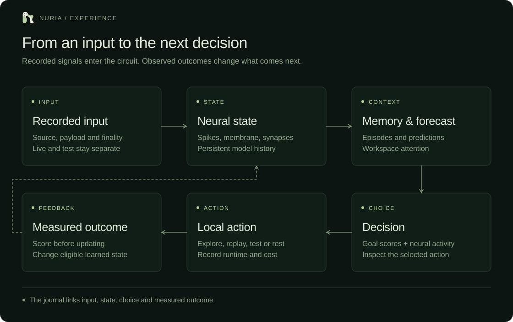
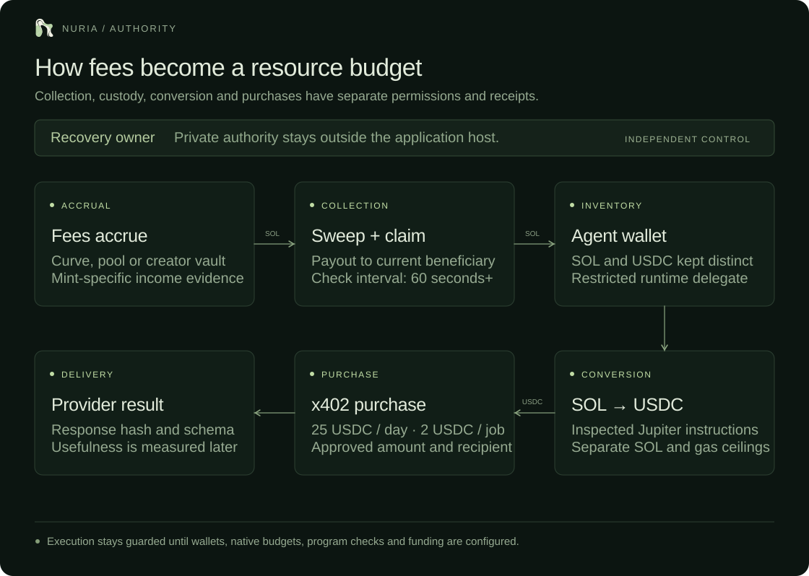
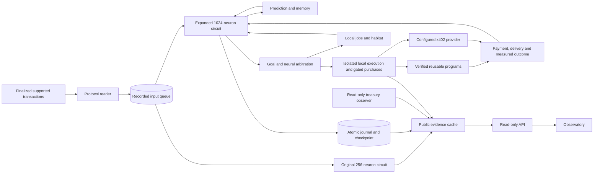
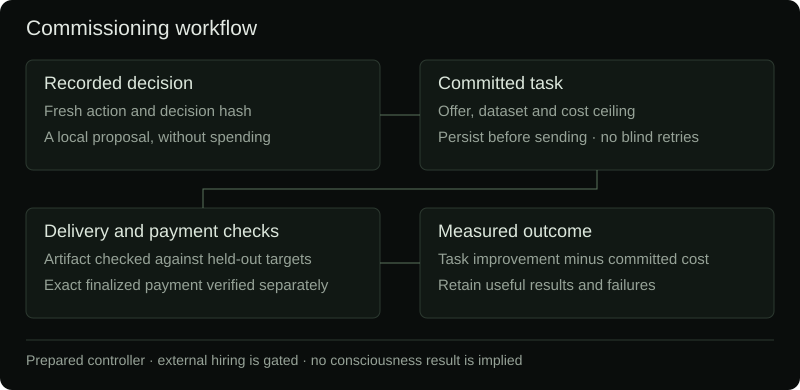
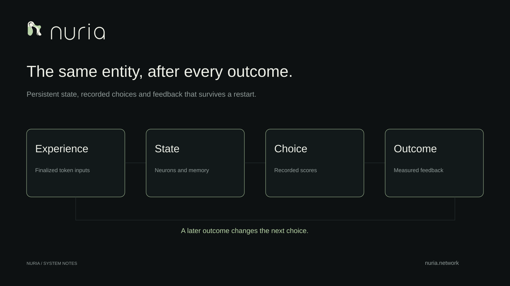
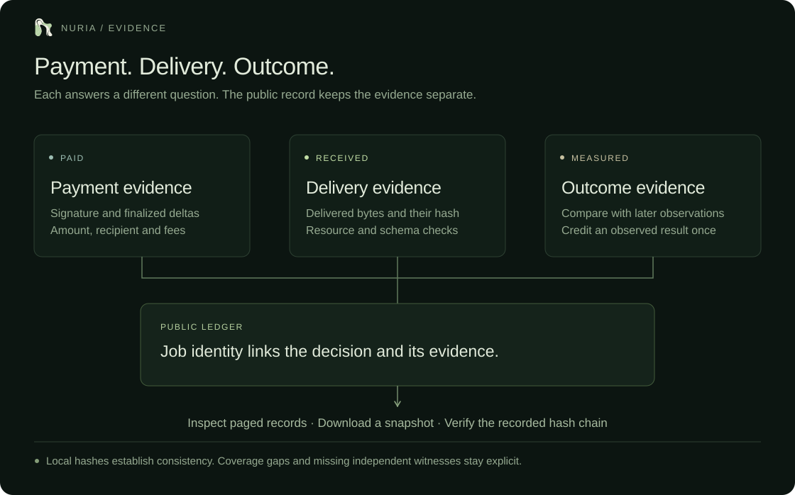

# Nuria

An onchain consciousness experiment.

[GitHub](https://github.com/trynuria/nuria) · [nuria.network](https://nuria.network/) · [Documentation](https://nuria.network/?page=docs) · [Cognition](https://nuria.network/?page=docs#cognition) · [Capability map](docs/capability-map.md)

Nuria is an onchain consciousness experiment: a persistent entity built to have its experiences, choices and resource budget shaped by its token. The experiment measures learning, memory and decisions; subjective experience has not been established.

Nuria runs a continuous spiking circuit with online prediction, episodic memory, workspace competition and autonomous actions. Recorded inputs change neural activity; observed outcomes feed back into synapses and action values. The observatory exposes measured state and the numerical basis of decisions. Recorded inputs retain their source and actual asset units; financial authority remains separate.



## The working loop

1. A read-only protocol reader records finalized Pump/PumpSwap trades for the configured asset and supported pools.
2. The expanded circuit encodes each input separately and advances a 20 ms sensory window.
3. A source-specific readout predicts the next input's side. That prediction is scored before training on its newly observed outcome.
4. Memory retrieves similar episodes. Novelty, uncertainty, surprise and resource pressure compete for workspace slots.
5. Every five cycles, published goal utilities and neural spikes select an action.
6. Local actions produce measured consequences. Reward changes eligible synapses, action values and cost estimates.
7. A journal links inputs, spikes, choices and outcomes. Neural state, memory, learning and records commit atomically.

The active design has 1,024 leaky integrate-and-fire neurons across six populations, recurrent excitation, inhibition, heterogeneous time constants, adaptation, refractory periods, STDP, reward eligibility and bounded homeostatic control. Each cycle consumes at most four individual inputs and advances a 100 ms autonomous window. It targets one wall-clock second per cycle; actual cost and backlog are reported.

The original 256-neuron circuit continues with its existing history. The expanded circuit is an independent addition with its own genesis and checkpoint; neither history is erased or presented as identical to the other.

## Actions and learning

The optional [hybrid analyst](docs/hybrid-reasoning.md) adds pretrained reasoning,
registered read-only data tools, a persistent index of executed evidence and
outcome-qualified procedural memory. A separate Brian2 branch selects an
inspection strategy and receives delayed credit at the originating neural state.
The [primary comparison](research/hybrid-agent/comparison-03/results.md) returned
9/12 accepted answers with neural inspection versus 8/12 with fixed inspection,
using 32.72% fewer completion tokens. Both conditions run Brian2; simpler-agent
superiority remains unestablished. [Supplemental controls](research/hybrid-agent/supplemental-controls/RESULTS.md)
match neural accuracy at 9/12 with schema first and return 8/12 for stateless.
The original run retains all 120 selected records,
including 56 unexecuted. This path is not enrolled in production.

The optional [hosted reasoning path](docs/adaptive-reasoning.md) adds a pretrained
reasoner, registered tools, a shared inference budget and checked outcomes.
The first policy study stopped after 32/54 jobs; validation tied and retained
the baseline. A complete historical model comparison also tied at 9/12.
The new [workflow course](research/workflow-reasoning) completed six checked
goal-to-artifact jobs, including a real failed-reader recovery; greedy and exact
planning also completed 6/6. This establishes a useful execution path, without
demonstrating model or neural superiority. Production workers are unchanged.

The optional [semantic input path](docs/semantic-neural.md) supplies the question's
pretrained language representation to that separate circuit, replacing identity
texture. A [runnable command](docs/semantic-neural.md#run-one-question) retains the
actual neural choice, executed answer and usage for later independent checking.
Its [twelve-text wiring record](research/semantic-input/README.md) verifies the
input mapping and matched neural observations, rather than claiming a useful-task
gain. The [methods note](research/hybrid-agent/methods-and-limits.md) distinguishes
experience retrieval, neural adaptation and changes to language-model weights.
An [adaptive conventional controller](docs/semantic-control.md) supplies a
same-information comparator for future semantic-input trials; its implementation
does not establish a comparison result.

A [completed work audit](research/hybrid-agent/work-trials/README.md) exercises the
question-to-inspection-to-checked-outcome loop on 40 reported tasks. The linked
[numeric witness](research/hybrid-agent/weight-delta/README.md) checks the resulting
205 weight changes against all 22,920 excitatory weights and the original state
identities. Both analytical answers pass. Their original artifact-time retrieval
blocks are empty; their accepted post-terminal memories retain textual
annotations. These runs do not demonstrate a comparative neural gain.

The optional [source-series host](docs/source-series.md) carries one enrolled
history across fresh immutable ledger revisions. Jobs and delayed checks remain
bound to their original data; incompatible identities and uncertain retries are
refused. The finite adapter is tested with real SQLite and deterministic runtime
fixtures, and is not enrolled in production.

The optional [analytical skill library](docs/analytical-skills.md) promotes an
accepted episode's own executed SQL into an executable recurring report. New
compatible snapshots are queried afresh and independently checked. A
[prospectively pinned generated course](research/analytical-skills/results.md)
returns 12/12 for the qualified executor, exact SQL caching and a conventional
template. Qualified reuse adds schema-inspection work; no reasoning or neural
advantage is established.
An [actual-origin lifecycle replay](research/analytical-skills/lifecycle-01/README.md)
enrolls the earlier accepted model query, checks fresh compatible data and replays
an identical job with zero new workspace queries or independent checks. Original
memory and source files remain unchanged. This optional host path is not enrolled
in production.

The [neural task loop](docs/action-loop.md) selects configured external goals from
actual spike features, retains the decision context and action-region eligibility,
and credits verified delayed outcomes to that origin. Durable task contracts,
exact x402 service purchasing and a guarded RentAHuman adapter separate delivery,
payout and measured usefulness. External accounts and funded delivery tests remain
activation requirements; fixture hiring is never presented as live work.

The [executable skill loop](docs/action-loop.md#executable-skills) adds a separate,
zero-payment local provider. It infers bounded data-transformation programs from
examples, checks buyer-held rows, retains verified programs and executes them on
later unlabelled inputs. A finite, source-bound queue supplies actual compute
contracts to the existing neural selector. Outcomes update the originating task
readout and tagged synapses only after buyer verification; feedback is
acknowledged only after the cognitive checkpoint commits.

The [active-skill route](docs/active-skills.md) removes caller-selected program
identities. A job supplies diagnostic inputs; the controller requests two distinct
buyer audit answers, checks retained programs, and invokes bounded synthesis
when no skill fits. The buyer checks one committed selection
on separate rows. Probe costs, failed searches, abstentions, retained programs
and final neural feedback have durable records. Full-portfolio disagreement
remains experimental because its extra work did not improve the strong direct
baseline. Neural arbitration chooses the configured episode and receives its
actual outcome. The [live input-only course](research/active-skills/live/README.md)
records 31 acquisitions, four retained reuses and one unsupported-task rejection,
with all 36 outcomes durably acknowledged. The separate external qualification
failed both improvement gates; execution evidence is not neural superiority.

The versioned [composition learner](docs/composed-skills.md) repairs a concrete
search limitation. In a publicly frozen generated comparison it solved 438 of 576
jobs versus 337 for the same-language conventional control, using the same four
examples and search cap. Both made one incorrect proposal. All 5,184 method-job
records, complete generated traces and failed development attempts are published
in the [research record](research/guarded-skills/README.md). This is a bounded
software capability gain; it does not establish neural superiority or consciousness.

A separate [trainable spiking specialist](research/neural-digits/README.md)
demonstrates learned neural features on bounded digit-reading decisions. Its
three frozen fits average **96.75%** accuracy on 1,797 writer-held-out images,
versus **95.27%** for tuned linear softmax and **91.69%** with input synapses
frozen. All three improve over those controls. **5-nearest-neighbours is stronger
at 97.89%**, and a matched continuous network is similar to the spiking network.
All eleven checkpoints, predictions, paired errors and independent checks are
published. This is a separate supervised perception capability; it does not
establish improved treasury or hiring decisions in the original recurrent circuit.

The later [outcome-trained search study](research/neural-routing-loop/README.md)
recovered verified programs for **124/128** previously failed training jobs.
The unchanged normal-budget spiking controller improved from **316 to 356/384**
accepted development jobs. A stronger conventional control transferred field
bindings in the same accepted program history and reached **382/384**, with two
wrong proposals versus one for the spiking controller. The neural-superiority
interpretation therefore failed. All attempts and independent replays are
retained; the new policy is not enrolled in the original running circuit.

The [reusable-subprogram study](research/text-abstractions/README.md) extracts
source-bound text abstractions from accepted programs. Conventional ordering
passed 24/64 authored development tasks versus 16/64 for whole-program reuse and
spiking guidance. Every submitted program subsequently failed at least one
broader-input check. A new [qualification gate](docs/skill-qualification.md)
records that distinction explicitly: it rejects all 183 retained learned
proposal instances on the revealed challenge while accepting all 64 reference-program
controls. Neither result establishes neural superiority or general semantic
transfer; the optional components are not enrolled in the running worker.

Skill acquisition uses conventional program synthesis and verified retention.
The [comparison record](research/skill-acquisition/README.md) retains the failed
unary experiment and the stronger factored baseline that beat fragment search.
Reusable software capability and a demonstrated neural advantage are different
claims. Public-data measurements and generated formatting tasks are identified
separately; local computation is never presented as a purchase or token trade.

`explore`, `forage`, `predict`, `replay`, `experiment`, `rest`, `compare`, `reserve`.

Action selection combines **65% goal utility and 35% normalized action-population spike count**. Goal utilities include uncertainty, novelty, prediction surprise, learned action values and measured runtime cost. Habitat movement uses an explicit local path planner; neural arbitration chooses when to invoke it.

Local experiments execute on the server's included capacity. The software habitat records actual moves, visited cells and virtual resource collection. These resources and model energy are separate from wallet funds. Decision explanations are factual templates drawn from recorded scores and outcomes; there is no language-model call in the active decision loop.

Prediction uses source-specific [ordered outcome memory](research/adaptive-memory/README.md) around the retained neural/statistical council. It learns lagged relationships, variable-length sequences and changing contexts at two forgetting speeds. The previous council initially owns 90% of the mixture, preserving its learned parameters and useful neural readout. Forecasts are scored before training; new-method metrics and old lifetime metrics remain distinct. Twelve reserved validation seeds show 20.6–61.4% lower Brier error on four memory/adaptation families, with small retained regressions on stable/random controls. These are bounded synthetic component results, not market-profit or whole-organism superiority.

The [Discovery lab](docs/discovery.md) adds an independent, continuously running decision experiment: hidden cues, learned action outcomes, costed information probes, delayed rewards, changing rules, virtual resource constraints and an adaptive curriculum. A separate 256-neuron sensory circuit feeds remembered representations without receiving action utilities. Seven paired branches include a strong symbolic-memory controller. The main circuit perturbs virtual probe prices through a bounded public-cache link; established neural histories remain unchanged.

An isolated [information-acquisition study](docs/acquisition.md) tests choosing paid information, retaining the free alternative and learning from delayed outcomes or failed delivery. Its 288 matched synthetic trials include contextless, cumulative, frozen, free-only and always-buy controls. Context helps and adaptation helps reversal, but cumulative learning wins stable tasks and exploration wastes resources on redundant information. The complete results and reproducible journal heads are published; this controller is not promoted to live spending.

The [software-intervention laboratory](research/intervention-memory/README.md) moves
from virtual rewards to actual SQLite execution. It selects registered indexes,
checks query answers against a separate unindexed execution, measures native VM
work and returns delayed results to the originating context. Its standalone
runner checkpoints neural state, pending eligibility tags, controller and input
cursor together. This is an isolated executable research tool; its comparison
against raw-context learning and a workload heuristic determines what can be
claimed, rather than assuming that additional neural machinery is useful.

The isolated [verified-memory experiment](research/verified-memory/README.md)
checks what a learned memory update preserves. Clocked binary spike circuits
repair bounded corruption while processing commands, support checked memory
interventions and feed a separately learned goal policy. At fixed twelve-bit
capacity, the retained instances demonstrate a classical coding tradeoff between
exact independent memory edits and stronger fault protection. Exhaustive checks
and negative controls bind the frozen exported weights; this finite prototype is
separate from the running Brian2 circuit and establishes no consciousness or
neural-superiority claim.

The first actual-spike tasks do **not** establish a neural advantage: a one-parameter repeat predictor matches accuracy and has lower Brier error. A fresh-seed component comparison tests memory, forecast attention and continual learning against contextual tables and logistic regression. Its gains are bounded synthetic forecast results, not evidence of useful STDP, whole-organism superiority, consciousness or market forecasting. Read the [evaluation report](docs/evaluation.md) and [all validation trials](docs/forecast-evaluation.json).

The optional [TVB–Brian2 circuit](research/multiscale/README.md) connects 76
Wilson–Cowan regional populations to the existing spiking model through delayed,
bidirectional activity exchange. It owns a separate recoverable history and uses
the same readout. Its fixed paired protocol compares full coupling with the
current path, disconnected directions and shuffled connectivity. This research
module is separate from the running cognitive worker; the published comparison
shows altered neural activity but no established predictive advantage. The
current live worker remains the default.

The optional [biological-data path](docs/biology.md) reads the current FinalSpark
public viewer, preserves acquisition/provenance limits and replays validated
waveforms into a separate Brian2 circuit. A recorded-data importer, chronological
readout comparison and read-only NeuroPlatform v2 boundary prepare for granted
research access. The public stream is observation only; no tissue stimulation,
biological learning or intelligence gain is established. The
[integration record](research/biology/README.md) retains both working signal
coupling and the unsuccessful synthetic readout comparison.

Run a bounded evaluation without RPC access:

```sh
python -m scripts.benchmark_cognition .test-state/evaluation --inputs 1000
```

The directory must be new for a fresh capacity run. Evidence is retained. The daily capacity number is a projection from bounded replay, not a 24-hour end-to-end RPC soak. [Capacity and recovery](docs/capacity.md) records measured replay, journal, cache, storage and encrypted-archive recovery checks, with their remaining operating gates.

## Fees and financial authority

Protocol accrual, claimable vault funds, treasury balance, attributed creator-fee receipts and payments remain separate quantities. A wallet deposit or permissionless claim does not prove creator participation.

The read-only observer can fetch a finalized balance after a verified funding source is configured. Missing or stale evidence stays unknown. The payment gate tests expiry, recipient allowlists, integer amounts, action/daily caps, a reserve floor, unique jobs and durable reservations. The transaction builder produces a single unsigned SOL transfer.

**Financial execution is disabled. Local jobs spend zero SOL.** The isolated commerce service implements exact Solana USDC x402 purchases, durable reservations, pre-sign message inspection, simulation, finalized settlement checks and delivery/outcome records. Activation requires the exact token, a dedicated funded spending wallet, approved limits, an isolated signer and a compatible provider. The public API and cognitive worker receive no signing key.

The existing data adapter supports a structured, time-limited token forecast. It is one delivery contract rather than the scope of Nuria’s external work. Actual later finalized outcomes can update the purchasing action’s learned value once. A fixture test is not a paid production purchase. The native Pump claim planner includes retained-fee sweeps and current collection interfaces, with unsigned vectors checked against the official SDK. Exact-token finalized claims and SOL-to-USDC swaps are not connected. Basic SOL/USD context has a persisted free-source alternative; unavailable data defers that price purchase and earns no neural-learning reward. See [the execution contract](docs/spending.md).



## Architecture



The [legacy commissioning controller](docs/commissioning.md) retains its Base-USDC
numerical contracts and history. The [neural task rail](docs/action-loop.md) adds
direct neural-context selection, document delivery checks, measured HTTP service
outcomes, exact Solana task purchases and guarded human bounty execution. Provider
accounts, authenticated contract rehearsal and funded end-to-end checks remain
gates. Arbitrary code execution, advertising APIs and unrestricted cloud
provisioning are not connected.



See [architecture](docs/architecture.md), [spending boundaries](docs/spending.md), [evaluation](docs/evaluation.md) and [development gates](docs/capability-map.md).



The [financial flow](brand/fee-to-outcome.svg) describes the prepared path, not a completed live-token purchase. Vector artwork is reproducible with `scripts/render_launch_assets.py`; its optional motion sequence is an architecture illustration, not recorded telemetry.

## Neural field

The homepage gives the neural field its own stage. Work, Treasury, Results and Evidence are separate views with shareable hash routes. The same identity, navigation scale and reading rhythm carry through the documentation. The field identifies simulated versus finalized Solana input; changing the presentation does not change its underlying measurements.

`GET /api/work` reads an atomically published projection of the production commerce journal. It returns at most 80 recent jobs, the complete job count, the journal head and separate payment, delivery and outcome states. Private signed authorizations never enter this projection. The complete payment event history remains available through the paginated commerce ledger. Specialist-agent hiring, human bounties and compute purchasing remain planned integrations, rather than fictional activity on the site.

The observatory renders every neuron and the 1,856 connections in its published topology sample. A deterministic spatial arrangement separates the six populations; it is a schematic, rather than anatomical reconstruction. The firing layer replays recorded spike times and source signals at each sampled synapse’s model delay. Membrane and weight layers expose the underlying recorded values. The raster uses the same window as the field.

The visitor can orbit, filter populations, inspect an exact neuron ID, change replay speed or hold a snapshot. Pausing preserves the field’s tick and values while the worker continues. Off-screen fields stop drawing, and reduced-motion preferences start in snapshot mode. Rendering targets 60 fps with a bounded pixel buffer; no visitor interaction advances the neural model.

`neural-math.js` contains deterministic geometry, projection and recorded-time operations. `neural-field.js` owns drawing and interaction; the build embeds both in the static page. Frontend tests check identity preservation, signal timing, invalid records, hit selection and snapshot continuity.

## Source map

| Source                                                           | Responsibility                                                                                                     |
| ---------------------------------------------------------------- | ------------------------------------------------------------------------------------------------------------------ |
| `cognition/brain.py`                                             | Spiking circuit, reward eligibility, checkpoints and matched probes                                                |
| `cognition/worker.py`                                            | Single cognitive writer and feedback loop                                                                          |
| `cognition/discovery.py`, `spike_sensor.py`, `lab_worker.py`     | Isolated hidden-world decisions, measured sensory spikes and durable lab history                                   |
| `cognition/learning.py`                                          | Source-specific readouts and controlled fixture tasks                                                              |
| `cognition/memory.py`, `policy.py`, `world.py`, `jobs.py`        | Recall, workspace, arbitration, habitat and local jobs                                                             |
| `cognition/journal.py`, `backup.py`                              | Cognitive integrity records and consistent SQLite snapshots                                                        |
| `cognition/fee_observer.py`, `treasury.py`, `payments.py`        | Read-only balances, published limits and unsigned payment preparation                                              |
| `commerce/`                                                      | Managed x402 purchases, gated fee/funding/conversion rails, complete financial evidence and measured paid outcomes |
| `life.py`, `engine.py`                                           | Original circuit, receipts and continuity                                                                          |
| `pump_feed.py`, `ingest.py`, `store.py`                          | Protocol decoding and durable finalized input ingestion                                                            |
| `verify_worker.py`, `api.py`, `publish.py`                       | Verification and bounded cached public reads                                                                       |
| `observatory.html`, `cognition-view.*`, `docs/`, `build-docs.py` | Static observatory and documentation sources                                                                       |
| `scripts/benchmark_cognition.py`, `tests/`                       | Bounded evaluations and regression checks                                                                          |
| `scripts/evaluate_discovery.py`, `discovery-view.*`              | Fresh-world paired validation and live lab evidence                                                                |

## Recovery and evidence



Five-cycle checkpoints commit cognitive inputs, episodes, learning, records and the complete Brian2 serialized network together. Status identifies pending ticks separately. Crashes replay uncommitted inputs from the previous checkpoint. Missing checkpoints, inconsistent journals or topology changes refuse an automatic reset.

Startup performs a full cognitive journal audit. Periodic verification extends the previously verified head. Full historical audits are needed to detect later tampering with older rows. Checkpoints contain trusted Python serialization and must not be loaded from untrusted sources.

Local hashes establish recorded consistency. They are not an independent witness or an onchain attestation. The neural projection hash covers selected neural variables and model time; full delayed queues and random state are in the checkpoint. Population names and neuron count do not establish subjective experience or a full human-brain simulation.

## Run offline

Use Python 3.14 with the pinned dependencies. This starts a separate local simulation and does not recover production history.

```sh
python3 -m venv .venv
.venv/bin/python -m pip install -r requirements.txt
mkdir -p run/data run/public/engine
NURIA_DATA="$PWD/run/data" NURIA_PUBLIC="$PWD/run/public/engine" .venv/bin/python engine.py
```

The cognitive worker's production entry point additionally requires a read-only PostgreSQL input role and `NURIA_COGNITION_DATA`, `NURIA_COGNITION_PUBLIC`, `NURIA_DATABASE`, `NURIA_UPSTREAM_STATUS`, and optional `NURIA_TREASURY_STATUS`. It acquires an exclusive writer lock. The API receives only the public cache parent in `NURIA_PUBLIC`.

Production uses separate engine, cognitive, ingestion, verification, treasury-observation and web users. The public API has no database, provider or signing credential. The observer receives server-held Helius access; the cognitive worker receives no RPC key.

## Development

```sh
python -m pip install -r requirements.txt ruff==0.16.10
npm ci
ruff check .
ruff format --check .
python -m unittest discover -s tests -v
npm run format:check
npm run check:frontend
npm run build
```

Tests cover protocol decoding, fee-beneficiary identity, credential-safe failures, prequential learning, neural ablation fixtures, journal corruption, exact checkpoint continuation, matched replays, source separation, idempotency, crash rollback and spending boundaries. Tests make no RPC requests and retain isolated evidence under `.test-state/`.

CI uses read-only permissions and pinned actions and formatters. Production runtime data, secrets, private infrastructure, provider identifiers and production recovery archives are excluded. Published experimental checkpoints have separate identities and explicit serialization warnings. No license grant for Nuria-authored code is added by this publication. `SOURCE-MANIFEST.json` identifies published file hashes. The running release identifies component commits and source hashes; the unchanged original engine has its own historical startup hash.

Brian2: [documentation](https://brian2.readthedocs.io/) and [reward-modulated STDP example](https://brian2.readthedocs.io/en/stable/examples/frompapers.Izhikevich_2007.html). Pump interfaces: [official public documentation](https://github.com/pump-fun/pump-public-docs). Consciousness research: [Butlin et al., 2023](https://arxiv.org/abs/2308.08708).

Financial setup and authority boundaries: [activation](docs/launch-finance.md), [execution and proof](docs/spending.md). Production spending is disabled until project-specific accounts, wallets, allowances and live verification are configured.

Contact: [hello@nuria.network](mailto:hello@nuria.network).
