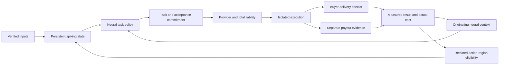

# Neural tasks and external outcomes

The task loop connects a recorded neural decision to a committed job, checked
delivery, separate payout evidence and delayed learning. The original local
actions and their history remain intact. External execution starts disabled.



## Neural decision and delayed credit

Every five cognitive cycles, the policy can choose among sixteen configured goal
contracts. Its context contains a bias and sixteen averages of the actual 64
normalized spike features. Regularized linear utility and an uncertainty bonus
score each goal/provider role. A small, disclosed hash-derived neural readout
supplies the initial preference. This prior is an engineering choice.

Ridge learning uses an exploration multiplier of 0.15 and discounts past evidence
by 0.995 per observed outcome while preserving the identity ridge. Role identity
includes goal, provider, kind, action and verifier. New datasets get new contract
commitments without erasing the role's accumulated learning. State is bounded to
32 role models and 32 pending decisions. An occupied goal cannot create another
intent until its request closes.

Each intent commits the contract, neural projection hash, cursor, tick, context,
candidate scores and eligibility-tag hash. Commerce accepts only a fresh
journalled decision at or before the committed cognitive tick. Public API
requests cannot create intentions or execute tools.

The checkpoint retains the originating context and up to 256 eligible excitatory
synapses into the selected action population. Delayed credit changes those tagged
weights by `0.002 × reward × stored eligibility`, within existing weight bounds.
It does not reward unrelated activity at the time a contractor finishes. The
readout, tagged weights, outcome record and feedback cursor commit atomically.
Commerce paginates after the committed feedback cursor, not the newest in-memory
cursor. A crash therefore cannot acknowledge an outcome whose learning was rolled
back. Exact retained duplicates have no effect; a changed receipt is refused.
The receipt window is finite. Older migrated feedback is rechecked semantically
against the audited cognitive journal; its original raw bytes are not invented.

Tests establish neural-context influence and exact delayed weight changes. They
do not establish biological fidelity, a general neural advantage or consciousness.

## Acceptance and usefulness

Contracts contain a purpose, brief, provider, total ceiling, deadline and reviewed
verifier. A private random evaluation nonce prevents low-entropy targets from being
enumerated against the published contract hash. `scripts.prepare_task` creates it
and writes the validated task to a new mode-0600 file. Held-out targets, nonce and
baseline vectors stay private. Public records
contain commitments and measurements, excluding private briefs, targets,
credentials and human submissions.

- **Predictions:** bounded probabilities tied to the exact task and dataset;
  the buyer recomputes held-out Brier gain and retains negative results.
- **Documents:** bounded JSON text with required sections and length. Structure
  and delivery do not earn positive usefulness credit by themselves.
- **Transform programs:** a reviewed, typed expression tree must reproduce exact
  buyer-held outputs. Four visible examples, a separate counterexample partition
  and untouched final rows have distinct roles. At most two search rounds share
  one allowance. A failed candidate contributes observed work and failure evidence.
- **Retained-skill execution:** a source-bound skill ID processes new unlabelled
  inputs without receiving expected outputs, training examples or an executable
  source file. The buyer checks the actual returned values. Missing skills cannot
  trigger an undisclosed synthesis fallback.

An additional HTTP availability objective measures actual service delivery. The
endpoint, response-body hash, latency bound and observation window are committed
before purchase. The buyer records a completed HTTP baseline, then at least three
observations at intervals of at least sixty seconds after delivery. DNS, TLS and
transport errors remain unknown; they are not convenient zero baselines. A
successful response must match the committed body and latency bound. Utility is
the change in observed success rate, rather than a contractor's self-score.

For measurable, settled work:

```text
reward = clamp(measured utility − 0.01 × verified USD cost, −1, 1)
```

Payment, delivery, acceptance and utility remain separate. A paid report can
remain unscored. The availability comparison is operational evidence, not a
randomized attribution of improvement. Creative quality, advertising impact,
arbitrary code and physical work require additional evaluators.

## Executable skills

A local included-capacity provider closes a concrete software-learning loop:

1. The neural task policy chooses a queued contract from actual spike context.
2. A bounded solver proposes a declarative data-transformation program.
3. Buyer checks can release one counterexample from a separate validation set.
   Final evaluation rows never enter search.
4. Only an exactly verified outcome can retain the program as a usable skill.
5. A later contract executes that retained skill on fresh inputs without labels.
6. The result, observed work, program identity and originating neural intent are
   journalled. Verified utility returns to the original context and eligibility.

For example, separate input fields may require unit normalization before their
sum recovers a public record's total. The typed language supports field selection,
bounded string cleanup, exact Decimal conversion and registered arithmetic. It
cannot run Python source, shell commands, filesystem operations or network calls.
Input bytes, tree depth, node count, search states and work are bounded.

This is conventional program synthesis and retention. A stronger factored solver
outperformed the initial learned-fragment search, so additional machinery does
not automatically become the production method. The
[full development evidence](../research/skill-acquisition/expressions.md) preserves
that failed comparison. A useful-skill benefit must survive the same strong
solver with and without retention; neither changed synapses nor cached answers
alone establishes a neural advantage.

The [preregistered retention comparison](../research/skill-acquisition/retention.md)
then holds the strong solver fixed. Across twelve reserved streams and 4,896
actual executions, all three methods achieve 100% exact file correctness.
Retaining verified programs reduces measured CPU per correct file by 51.9% and
counted work by 54.9%, including acquisition, admission and buyer checks. This is
an amortized efficiency improvement on recurring generated formats over public
observations, not a demonstrated increase in general competence or neural
superiority. The independent verifier reconstructs outputs and accounting;
recorded CPU durations are not independently attested.

The finite queue commits its source manifest and every concrete task. Completed
contracts remain consumed in the commerce ledger even after the neural receipt
cache evicts older entries. Executed failures remain terminal evidence;
unexecuted cancellations can retry within the provider's unchanged limits. Queue
exhaustion disables planning rather than generating replacement activity.

Included-capacity authority is explicit and independent of monetary authority.
Only a configured local provider can dispatch a zero-payment skill contract while
financial execution is off. Separate job, work, daily and cooldown limits apply.
An interrupted computation retains its full reservation and reports unknown work;
it is never described as free to repeat. Failed persistence restores the last
durable library before another request can use that adapter instance.

Buyer catalogues live in a private shared directory outside both public caches
and the static website root. Published records contain program ASTs, commitments,
work counts and exact-row measurements, excluding private validation values.
The research uses real public observations with explicitly generated formatting
and source-derived arithmetic. It does not establish performance on arbitrary
customer data, consciousness or whole-organism superiority.

### Running a bounded skill queue

`commerce/local-skills.example.json` declares the reviewed expression language,
retention method and finite compute ceilings. Both its local provider and the
separate financial switch start disabled. To enable only included computation,
set that provider's `enabled` field; leave the top-level financial switch false.
Keep its provider ID, source ID and language configuration stable after the first
accepted program. A changed source or language needs a new provider namespace.

`scripts.build_skill_queue` converts a declared corpus into new private contracts:

```sh
python -m scripts.build_skill_queue research/skill-acquisition/retention-tasks.json /private/task-input/manifest.json --provider local-record-skills-v2 --solver-work 100000
```

The builder uses only input/output rows and the declared language. Generator
recipes, original field IDs and row metadata never enter a solver request. A
manifest's language must exactly match the enrolled provider. Source manifests
and contracts are immutable; create a new file for a new workload.

Configure `NURIA_SKILL_QUEUE` with a private JSON file containing `schema:
nuria.skill-queue.v1`, the absolute `manifest` path, its raw-file
`manifest_sha256`, the enrolled `provider` ID and explicit `enabled` boolean.
`NURIA_AGENCY_CATALOG` names the generated private catalogue read by both
workers. `NURIA_ACTION_CONTROLS` names the commerce-only provider controls.
The catalogue directory needs commerce write permission and cognition read
permission, with no API or other-user access. It must be outside all public roots.

A serving contract uses `transform_execution`, the same language and source,
an already verified `skill_id`, fresh `inputs`, buyer-private `expected_outputs`
and a finite `maximum_work`. The provider receives the inputs and skill identity,
not the expected outputs. A missing skill fails rather than teaching itself from
the answer. Queue progress, exact checks and verified serving counts appear in
the existing Work and Results views.

The separate `transform_active` contract removes that caller-supplied skill ID.
Its diagnostic inputs are visible, their outputs are released only through
committed probes, and all final rows remain with the buyer. Enroll a new
source/provider with mode `active_audited` for the measured two-example lookup
and synthesis policy; mode `active` retains experimental portfolio disagreement.
The builder `scripts.build_active_skill_queue` creates a finite new private
course without forwarding generator recipes or format identities. Its default
requires two distinct audit answers. Old providers, libraries and contracts keep
their identities and evidence. See [asking before acting](active-skills.md) for
the protocol, bounds, failure behavior and comparisons.

## Agent and service purchasing

An enrolled `nuria.task-result.v1` x402 merchant receives a bounded `X-Nuria-Task`
header with the public contract and result envelope. The merchant must implement
this interface: ordinary x402 support alone does not provide task execution.
An agent can fulfil an analysis task or a finite, prepaid service contract. No
general cloud account, subscription or production shell is granted.

The existing exact Solana-USDC executor owns invoice inspection, restricted
signing, simulation, durable authorization, finalized transfer verification and
ambiguous-payment recovery. Changed invoices are refused. Linked merchant and
task records count the payment once. The task rail separately verifies delivery
and usefulness.

Longer tasks may return a paid `nuria.task-ack.v1` acknowledgment with a bounded
expiry and private result token. This is recorded as paid acceptance, not artifact
delivery. The buyer polls the enrolled endpoint's `/results/<job_id>` resource;
it never repeats the payment. Result tokens stay in the private ledger and are
sent only to that fixed provider origin. Unsettled timeouts retain liability.
After a verified payout, a missing valid delivery at the committed deadline earns
a negative result with a failure-evidence hash; no artifact or refund is invented.

## Human hiring

The RentAHuman adapter previews a remote one-seat fixed-price bounty, funds from
an existing project wallet, ranks applicants using configured task-history
thresholds, accepts one applicant and reads evidence. No sensitive profile
characteristics enter ranking. A release request requires passing buyer-side
delivery checks.

Funding, hiring and release have separately persisted write intents. A timeout
does not permit repeating the write. Read-only reconciliation can establish an
accepted applicant or completed release. Ambiguous initial bounty creation needs
independent reconciliation; the bounty is not posted again.

Queued release and funded escrow do not establish worker payment. Authenticated
platform-confirmed payout is labelled separately from an independently verified
chain transfer. Unreported worker wallets remain unknown.

Activation requires a project account and authenticated no-charge rehearsal.
Private enrollment pins response fields, account identity, USD units and verified
gross-debit cap behavior. A preview is not an atomic price lock: the adapter
reserves the entire independently enforced per-bounty gross ceiling, including
fees, and requires automatic top-up to be off. Missing evidence refuses execution.
No signup, card checkout, wallet deposit or automatic top-up operation is exposed.

The official [RentAHuman documentation](https://rentahuman.ai/docs) describes the
bounty, applicant, escrow and payout interfaces. Its current crypto funding route
uses Base USDC; Solana funds are not treated as Base or marketplace inventory.
No project account has been enrolled and no human job has been posted.

## Recovery and publication

Merchant jobs, legacy commissions and action tasks share the daily ceiling,
cooldown and unresolved-job breaker. Tasks additionally enforce a lifetime
ceiling. Available inventory is specific to the actual funding account. USDC uses
nominal USD accounting; no bridge or stablecoin price guarantee is implied.

External writes are committed before disclosure. Ambiguity retains liability
across restart. Undisclosed requests can close without utility credit. Disclosed
work needs remote evidence; timeout is not cancellation or refund. Disputes and
refunds require provider reconciliation rather than an assumed local release.

The existing Work and Results views show purpose, neural intent, cost ceiling,
recipient when established, payout basis, delivery and measured utility. Their
visual design is unchanged. Complete events remain paginated. Feedback is served
in ascending pages after the cognitive worker's acknowledged cursor, avoiding
silent loss after an outage. Local hashes establish internal continuity, not an
independent witness.

## Activation

Keep populated catalogs and credentials outside source control. The examples
`cognition/agency.example.json` and `commerce/actions.example.json` start disabled
with no monetary authority. Both workers read `NURIA_AGENCY_CATALOG`; only commerce
reads `NURIA_ACTION_CONTROLS`. Marketplace keys are loaded through the enrolled
environment-variable name. The neural worker receives no signing or account key.

1. Define the actual goal, provider and buyer-owned outcome check.
2. Enrol its project account; verify authenticated response fields, gross costs,
   destination and fresh funding inventory.
3. Verify custody and finite job, daily, reserve and lifetime authority.
4. Run a bounded funded job and reconcile payout, delivery, failure recovery and
   delayed learning before broader use.

Tests retain isolated fixtures and actual Brian2 checkpoints. Fixture orders,
balances and payouts are never published as production work. Tests do not establish
that an unenrolled account or merchant works live.
