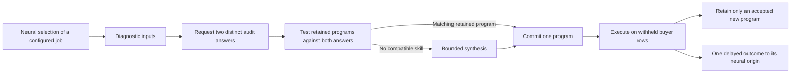

# Asking before acting

A retained program is useful only if the system can choose the right one. Two
files can have identical input shapes but require different units, fields or
business rules. Selecting a program by its position in a library does not solve
that problem.

The active-skill controller accepts a diagnostic input pool without a recipe,
format number or selected skill hash. Its production policy requests two distinct
audit examples, checks retained programs against those answers, and runs bounded
synthesis if no stored skill fits. Final acceptance remains a separate buyer
operation.

A separate experimental policy runs the full retained portfolio and chooses
diagnostics by output disagreement. Development found that this added work did
not improve correctness over the simpler audited route. The more complicated
policy is not the production default.

## One episode

The buyer's diagnostic answer is an actual tool response, with an input hash,
source, action ID, immutable receipt and charged disclosure work. The controller
does not receive the whole answer sheet. It sees no final scoring inputs or
targets while choosing a program. A final rejection cannot invoke a hidden
repair fallback on those scoring rows.

The production policy requires two distinct audit labels for reuse or new search.
The experimental policy can request one-label reuse, but that setting produced
incorrect choices in development and is not the selected default. New synthesis
always needs at least two distinct examples. A finite candidate set agreeing on
a few examples is not proof of arbitrary semantics. If the evidence or work
allowance is insufficient, the controller abstains.

## What learns

Accepted executable programs accumulate in a source-bound library. Reuse changes
what later jobs can execute without another search. The surrounding neural task
selector receives the final measured success or failure once, after the buyer's
check and durable cognitive checkpoint. It retains the original decision context
and eligibility tags rather than crediting whichever state happens to be current
when the result arrives.

Diagnostic selection uses engineered audit and output-disagreement rules. It is
not a learned neural probe policy. A configured finite queue supplies the jobs;
the controller does not discover arbitrary incidents or invent customer demand.
Program synthesis, candidate elimination and library reuse are established
methods. This integration is not a demonstration of a new learning algorithm,
consciousness or neural superiority.

## Execution and recovery

Each physical decision, probe and synthesis operation is reserved in SQLite
before execution. Its completed action, session checkpoint, delivery and later
admission must agree with the immutable event journal. Reopening an interrupted
physical operation leaves its cost uncertain; it does not silently rerun it.
Known capacity limits cause an explicit abstention before synthesis.

One provider has one active episode at a time. This prevents concurrent jobs from
overwriting a shared library. Pending proposals, diagnostic rows, program nodes,
work, jobs and library capacity are bounded. An accepted result at full library
capacity establishes correctness, not successful retention of another program.

The production contract currently qualifies only the existing numeric expression
language. The separate text language adds reviewed field extraction, casing,
fixed token classes, bounded slicing, concatenation, simple equality conditions
and numeric formatting. It executes declarative data programs; it has no process,
filesystem, network, arbitrary regular expression or wallet tool. External text
qualification is separate from production activation.

Included-capacity compute spends zero wallet funds. This controller cannot
activate payments, claim creator fees or change financial policy.

## Evidence and comparisons

The [active-skill research record](../research/active-skills/design-notes.md)
identifies the development data, external source, exact split and accounting.
The external source is Microsoft's pinned PROSE transformation suite. Its
selected tasks are independently authored synthetic examples, not customer jobs.
All unsupported tasks, abstentions and incorrect proposals remain in the
denominator. Raw external examples and complete private traces are not published
as a bulk corpus.

Fixed-example retention, active disagreement, random probes and a frozen library
receive the same grammar and bounded tools. Comparisons report exact task
success, usable coverage, diagnostic labels, total work and measured process CPU
separately. A method asking fewer questions while making more mistakes has not
established an efficiency gain.

The earlier [live verification](../research/skill-acquisition/live/README.md)
retains an operator dispatch error and its correction. The new route removes the
caller-supplied skill identity; it does not retrospectively relabel that earlier
operator fix as autonomous repair.

## Implementation

- [Controller](../cognition/active_skills.py): bounded candidate execution,
  diagnostic selection, synthesis and abstention.
- [Runtime](../commerce/active_skill_runtime.py): reservations, immutable actions,
  recovery, buyer-bound selection and admission.
- [Text language](../cognition/text_skills.py): reviewed data operations and
  verified program storage.
- [Evaluator](../scripts/evaluate_active_skills.py) and
  [independent checker](../scripts/verify_active_skill_results.py): frozen-source
  comparisons and separate output reconstruction.

The independent checker does not import the learned executor. It checks selected
labels, exact outputs, admission and declared arithmetic from retained evidence.
It does not independently witness physical CPU use or prove that an external
buyer was honest.
