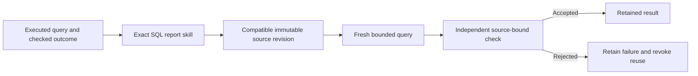

# Executable analytical skills

An accepted report should be usable again without copying its old answer. The
optional analytical skill library promotes SQL from a checked analytical episode
and executes that query on a new, compatible source snapshot. Each new output
still needs an independent check.

The existing procedural memory retains accepted SQL and textual annotations for
the reasoner. This addition makes exact report reuse executable. It does not
train the language model, infer a new report from a question or prove a neural
advantage.

## From an outcome to a report

Promotion requires the actual `ProceduralMemory` episode, its committed accepted
settlement and the retained receipt of its own successful final query. The library
checks their identities against the original registered database and the current
workspace implementation. A model-written procedure or an `accepted` flag in a
tool argument cannot promote a report.

The host assigns a stable report identity and an independent checker identity.
These are trusted enrollment choices. Hashes identify retained evidence; they do
not authenticate a remote checker or prove that its verdict was correct.

## New data, the same question

A report contract binds the database identity, complete SQL schema, static
knowledge document hashes and workspace implementation. Rows and the dataset
revision may change. Schema definitions, business meanings, document contents or
the host report identity may not change silently.

The executor reads the new registered source, inspects its schema and runs the
retained SQL through `AnalystWorkspace`. It never returns cached answer rows.
Successful query execution produces a pending result, not a correctness verdict.
The trusted host checker receives that exact execution and source identity before
its verdict is committed.

A rejected output revokes the skill. Checker exceptions leave it pending.
Repeated settlement returns the existing verdict. Repeated execution of the same
job returns its existing execution; a changed duplicate or an interrupted
reservation is refused.

## Finite operation

The library defaults to 32 skills and 1,024 retained events. It reserves journal
space for outstanding verdicts before starting a new query. The store has one
writer and a private SQLite journal. These limits cover the library's record
count, while the existing workspace supplies query deadlines, VM-step, row and
output-byte limits.

This version supports exact SQL with the default workspace limits and static
document contracts. It does not infer typed parameters, import every historical
episode, reconcile unknown execution automatically, roll history over or enroll
itself in the production worker. Financial authority and the original neural
histories are unchanged.

## Evidence and interpretation

The module tests exercise real SQLite sources, promotion provenance, fresh rows,
source incompatibility, rejected outputs, recovery and finite limits. A separate
generated-ledger course compares the executor with exact SQL caching and an
independently written conventional report template. All methods receive the same
rows and perform actual queries. No language-model calls are invented for a
baseline.

The course separates development from a pinned challenge protocol. Generated
ledgers, deterministic checks and known conventional queries are labelled as
such. Correct checked reuse is a useful software capability; parity with SQL
caching is not evidence of improved reasoning or intelligence. Schema inspection
also adds real work and is counted separately.

The live site design and production enrollment remain unchanged.
