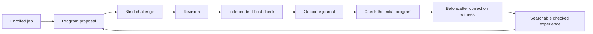

# Checked experience

The work loop retains programs and their independent execution outcomes. A
proposed lesson is not treated as a proven skill. When one program fails and
another passes under the same enrolled checker, the system can retain a checked
correction with both programs, their difference and the actual execution reports.



The blind challenge sees the specification and earlier experience, but not the
current proposed program. Its tests remain fallible. The final host check alone
decides whether the delivered program is accepted. Checking the initial program
happens after the final model request, so this feedback can inform later jobs
without leaking the current acceptance check back into the current proposal.

## What is learned

A correction records a failure followed by success on one source contract. It
does not establish that the edit works on other tasks. Both programs are bound
to the same checker and retained experience records. Candidate pairs that fail
independent replay are preserved and refused admission.

Completed work can acquire these witnesses automatically. The next job can
retrieve them without another model request to manufacture a summary. A host
can also replay contrasting historical outcomes with
`scripts.acquire_checked_repairs`. Neither path modifies foundation-model
weights or the original neural worker.

## Retrieval and controls

SQLite FTS5 indexes source groups, including their recorded variants. Repeated
attempts at the same task cannot fill every retrieval slot. A checked accepted
example represents each source when one exists; proposed lessons are labelled
as unverified. The navigation and static-retrieval methods receive identical
initial evidence. Navigation can then select targeted experience and checked
corrections for the challenge and revision. Static retrieval retains its original
selection. A third control runs the same three-stage workflow without memory.

The methods share the model, source corpus, executor and three-call completion
ceiling. They do not share a claim of correctness: every final program is judged
separately. Fresh-task proposals commit before any terminal test feedback is
released. Source-group diversity and equal initial information are applied to
the simpler control as well.

## Running actual work

```sh
python -m scripts.run_experience_course enrollment.json run/work \
  --config private-client.json --method navigation
```

The enrollment supplies finite jobs, source identities, inputs and trusted host
checkers. Network and unrelated user-file access remain blocked by the existing
OS executor. Identical completed job IDs return their receipts without further
model calls or program execution. Changed contracts cannot reuse an ID;
interrupted work requires host reconciliation.

The implementation provides a persistent work interface. It does not activate
a production service, confer financial authority or demonstrate consciousness.
Transfer claims require the separate comparisons in
[the complete research record](../research/outcome-learning).
