# Neural first-tool strategy

The optional [hybrid bridge](../cognition/hybrid_neural.py) connects an independent
Brian2 circuit to one concrete decision: whether a software-analysis job first
lists its database tables or reads its available background knowledge. The host
enforces that first registered tool before invoking the language model.

This is a new bounded laboratory history. It does not migrate the production
circuit, represent earlier token activity or establish improved task performance.
The language model remains responsible for reasoning about the question and SQL;
this circuit does not acquire language understanding from a question hash.

## Inputs and selection

The bridge accepts a job identity, workspace-context hash, question and the host's
past tool statistics. Inputs use `event=None`; no fabricated buy, sell, market cap,
fee or transaction enters the circuit.

A deterministic job/context/question texture supplies a bounded sensory drive.
The memory input combines that texture with each registered tool's observed
validity, uncertainty and cost. These are explicit engineering encodings. The
underlying `TaskLearningBrain` advances a declared **100 ms simulated window** by
default; allowed windows range from 20 to 100 ms. This duration is model time,
not measured wall-clock execution time.

Each strategy corresponds to an existing action population:

| First registered tool | Circuit action |
| --------------------- | -------------- |
| `list_tables`         | `explore`      |
| `read_knowledge`      | `experiment`   |

Declared utility combines past tool validity, posterior uncertainty and normalized
cost. It is an ordinary rule over observed tool statistics. Missing or censored
costs retain their unknown flag and use a fixed 100,000-unit conservative prior;
that prior is neither a measured cost nor an upper bound on future work.

The neural condition selects the largest score:

`0.65 × declared utility + 0.35 × strategy spikes / max(1, both strategy spike counts)`

The record includes actual window spikes, action spike counts, utilities, scores,
input encoding and neural-state commitments. Explanations report those facts;
they do not invent an inner monologue. The fixed ablation always selects
`list_tables` with zero neural selection weight. It still advances and records its
separate circuit, but its recorded spikes cannot change its first-tool choice.

```mermaid
flowchart LR
    A[Actual job and earlier tool observations] --> B[Bounded input encoding]
    B --> C[Independent Brian2 circuit]
    C --> D[Measured action spikes plus declared utility]
    D --> E[Commit origin and eligibility]
    E --> F[Host enforces the first registered tool]
    F --> G[Language model and read-only SQL tools]
    G --> H[Independent terminal checker]
    H --> I[Credit originating eligibility and checkpoint]
```

## Terminal feedback

The first-tool decision and originating action-region eligibility commit before
the bridge returns. Only the host may call `settle` after matching a verified
terminal result to that exact job. The model receives no grading tool.

Accepted outcomes map to neural feedback `+1`; rejected outcomes map to `-1`.
This signed neural encoding is separate from the procedural ledger's terminal
reward `0/1`. `TaskLearningBrain.task_reward` applies the signal to the retained
origin trace. The receipt identifies the job, decision, checker evidence and actual
tagged/changed synapses. Exact duplicate outcomes do not apply feedback twice;
changed duplicates and unknown origins fail.

Attributing an entire language-model job outcome to its first strategy may be
imperfect. A changed synapse proves that feedback was applied, not that the first
tool caused the outcome or that learning improves future decisions. Fixed-choice
and broader policy comparisons are required before making either claim.

## Separate recoverable history

Each new private lab binds source, pinned model identity, tool version, mode,
simulator/runtime versions and implementation hashes. A single writer owns the
history. Up to 256 distinct jobs and 64 unsettled decisions are admitted; reaching
a bound refuses additional work rather than deleting history or silently resetting
the circuit. Run one active bridge per process because Brian2 shares runtime
random-state machinery.

Every transition creates a new capsule containing the full trusted Brian2 network
checkpoint, pending eligibility, decisions, outcomes and hash-linked metadata.
Earlier capsules are never overwritten or removed. Only the small `HEAD.json`
pointer changes atomically. Reopening verifies the retained chain and restores the
network, random state, delayed queues and controller metadata together.

Wrong source, altered checksums, incompatible implementation and a missing head
are refused. An interrupted transition requires reopening; unreferenced capsules
remain retained. Recovery does not claim that physical compute happened exactly
once. These are trusted local Brian2 pickle checkpoints and must not be loaded
from untrusted sources. Local hashes are not an independent witness; rollback to
a complete earlier head needs an externally retained head to detect.

Tests exercise a real circuit, exact resumed weights and subsequent spikes,
origin-bound credit, duplicate settlement, immutable earlier capsules and failed
checkpoint recovery. A separate selection test confirms that changing measured
spike counts can change the neural condition's first tool while leaving the fixed
condition unchanged. These checks establish execution and recovery, not neural
superiority or consciousness.
