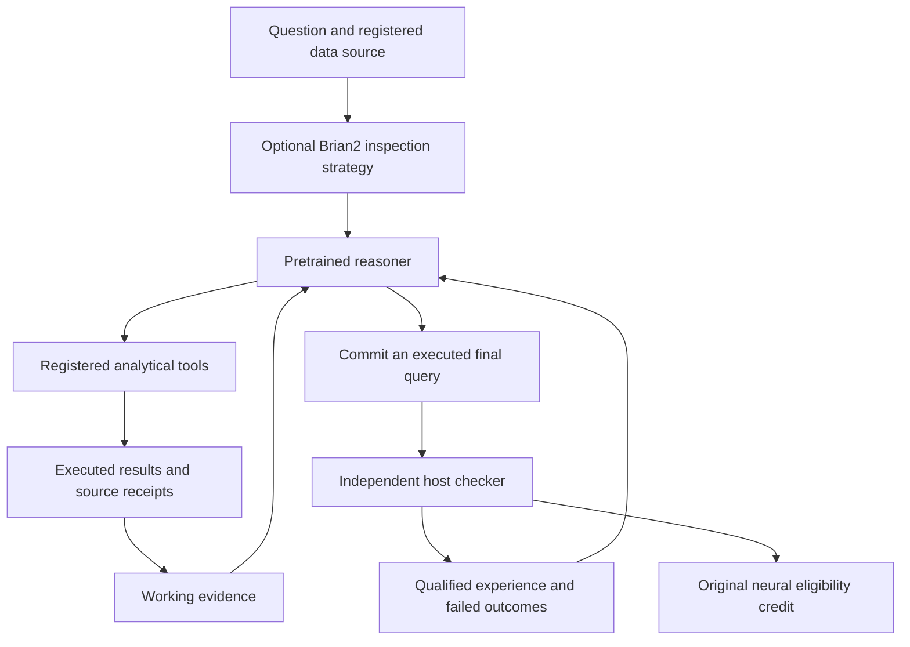

# Hybrid reasoning

The optional hybrid agent takes a natural-language data question, inspects a
registered database, executes queries and commits an answer with its execution
evidence. A pretrained reasoning model supplies language and planning. Brian2
supplies a separately measured adaptive state and an experimental first-tool
strategy. Existing production histories keep their own identities.

## Components

The development runtime uses a pinned four-bit
[Qwen3.8-27B](https://huggingface.co/Qwen/Qwen3.8-27B) conversion through
[MLX LM](https://github.com/ml-explore/mlx-lm). The model manifest records the
actual conversion revision and file identities. Foundation weights stay fixed
during the comparison; changes in procedural memory and synaptic state are
recorded separately.

The [analyst](../cognition/grounded_agent.py) chooses among four registered tools:
list tables, describe a table, read supplied knowledge and execute a read-only
query. Each execution returns source identities, complete results or an explicit
failure, and measured work. The model must execute its final SQL before it can
submit that exact query.

The [working-evidence index](../cognition/working_evidence.py) carries observed
schemas, document excerpts, query results and errors forward as older chat turns
leave the prompt. Its entries come from host execution receipts. Shortened views
identify omitted data while the full trace remains retained. A plausible model
statement cannot insert a fact into this index.

The [procedural memory](procedural-memory.md) retains the agent's own successful
queries and proposed methods after an independent terminal check. Failed work
also remains available as experience. A method annotation is a candidate for
reuse, not a universally proven rule; every later answer needs its own check.

The [Brian2 bridge](hybrid-neural.md) can choose the first registered inspection
tool from actual action-population spikes and declared utilities. The host
enforces that choice. Verified terminal feedback reaches the saved originating
eligibility trace. Immutable checkpoints preserve this laboratory's separate
neural history.

## What is learned

The system can retain a working procedure, its preconditions, the executed query,
the checked outcome and the limits exposed by failures. Tool statistics measure
observed execution success and cost; they do not equate a valid query with useful
progress. Terminal acceptance remains a different signal.

In the neural branch, delayed rewards change the original action region's tagged
synapses. The pretrained model does not learn language from that reward. Its
existing semantic competence and the contribution of Nuria's continuing
experience require separate comparisons.

This design draws on established experience-learning work such as
[ReasoningBank](https://research.google/blog/reasoningbank-enabling-agents-to-learn-from-experience/)
and [Memento-Skills](https://arxiv.org/abs/2603.18743). The task-state design also
addresses the unsupported assumptions and stale reasoning investigated by
[Agent-Editing World Model](https://arxiv.org/abs/2609.28416). Nuria implements a
host-grounded evidence index; it does not reproduce that paper's trained world
model or inherit its reported results.

## Checking a capability gain

The external course uses selected official Spider databases and questions. Its
development, teaching and reserved databases have distinct identities. Reference
SQL and expected rows stay outside the model's registered tool surface.
The checker preserves NULL values, duplicate rows, result types, column count
and required ordering. This is a small finite execution comparison, rather than
the complete official benchmark metric. Public benchmark pretraining
contamination is possible.

The prospective comparison separates the same frozen model with no persistent
memory, episode retrieval, procedural retrieval, a schema-first heuristic and
matched fixed/neural inspection strategies. Teaching outcomes settle immediately.
Reserved answers are committed as a complete batch before terminal labels can
affect later decisions in that batch.

All branches share declared completion-token, turn, tool-call and prompt-view
limits. Prompt tokens vary and are measured. Inference, retrieval, SQL work,
errors, abstentions and incomplete runs remain in the record. A circuit wiring
test, a correct isolated answer and an improvement over a serious comparator are
different results.

## Runtime and activation

The supplied client talks to an explicitly configured loopback model process.
Model weights and private workspaces stay outside the public repository.
Production inference capacity is a separate deployment requirement. Loading a
local model for development does not provision that capacity on the application
server.

Analytical delivery and semantic acceptance remain separate. A missing checker
leaves acceptance unknown. The agent has no wallet, signer, arbitrary command or
filesystem tool. Financial authority continues through the existing isolated
rails. The experiment does not establish consciousness or biological learning.

The optional [included-compute provider](../commerce/grounded_analysis.py)
connects this analyst to the existing task journal. A private registration pins
the question, database, model and inference limits. The host supplies the actual
analyst and separately registered terminal checkers; configuration alone cannot
create either authority. Delivery records contain public hashes and counts,
while SQL, rows and detailed traces remain private. Receiving an answer earns
no positive credit until its registered checker qualifies it.

The provider is disabled unless explicitly enrolled. Its execution is synchronous
and belongs in a dedicated worker, outside public request handlers. A reserved
job is never silently reissued after an interruption. Production model capacity,
data enrollment and an appropriate outcome checker remain activation gates.
