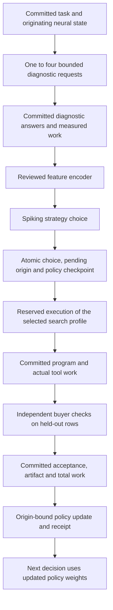

# Outcome-trained neural routing

An opt-in spiking policy can select an actual text-program search strategy and
learn from that strategy's later, independently checked result. Its transactional
bridge is implemented and tested. The existing task producer and deployed worker
are **not enrolled** in this policy.

The current development results do not establish superiority over a strong
conventional agent. In the two-strategy development comparison, the trained
spiking policy accepted **327 of 427 jobs**. An explicit rule using the same
disclosed examples accepted **355 of 427**, with two wrong proposals versus one
for the spiking policy. These are exploratory results, not a frozen qualification
or a claim about the original recurrent circuit.

## What the policy changes

The policy chooses how to search for a small, checked data-transformation
program. The available profiles change actual candidate visitation order within
the same safe text language, interpreter and finite synthesis allowance. For
example, `default` tries case operations early; `slice_first` spends its initial
search effort on slices. A different profile can therefore produce a different
program or exhaust its allowance before finding one.

The available implementations are `default`, `extract_first`, `slice_first`,
`split_first`, `replace_first`, `number_first`, `composition_first` and
`reverse_fields`. A routing authority declares its allowed subset and each
profile's cap, at most 50,000 synthesis work units. Changing search order is a
conventional tool improvement. Any additional benefit from learning to select
that order must be measured separately.

The policy's action values come from thresholded leaky integrate-and-fire
activity. Each observation produces input currents, repeated voltage updates,
hard spikes and normalized spike counts. A trained readout turns those counts
into values for the legal strategies. Initial coverage and exploration are
explicit recorded alternatives to a greedy learned choice.

Selected-action scalar regression trains the input weights, hidden biases,
readout weights and readout biases. A declared surrogate supplies a gradient
through the hard spike threshold; Adam and bounded replay implement the update.
This is an engineered task-conditioned spiking policy. It does not establish
biological learning, consciousness or a benefit from the established Brian2
circuit's own synaptic updates.

## Evidence and execution order



The diagram specifies the required producer flow. The encoder, policy, search
profiles and transactional choice/feedback bridge exist. The production adapter
that connects all of these stages remains an integration gate.

`RoutingDecision.decide(job_id)` reads an existing committed task and its completed
diagnostic operations. It checks source, provider, contract, originating intent,
neural-state commitment, audit receipts and source-specific library state. The
reviewed encoder receives only the disclosed diagnostic input/output pairs,
their receipt hashes, language limits, current library state, profile limits and
the 64 raw neural features recorded in the intent. It receives no final scoring
rows, final targets, task title, source recipe or evaluation nonce.

The current encoder has 128 coordinates: 21 conventional task observables padded
with 43 reserved zeros, followed by those 64 neural features. The task
observables summarize relationships such as direct projection, case conversion,
substring matches, lengths and character classes. The zeros are not neural
measurements. All controls must receive the same permitted observations. The
wrapper refuses an intent that lacks its actual 64-coordinate vector; it cannot
reconstruct that vector from the historical 17-coordinate pooled task context.

The selected strategy, feature commitment, originating library snapshot,
model/state identities, RNG and pending learning origin commit together before
synthesis. This commitment also fixes the language configuration, solve mode,
search mode, exact disclosed example pairs, profile caps and reviewed encoder
identity. The returned private execution plan contains that library snapshot and
those disclosed pairs; it contains no final scoring data.

The producer must reserve and execute this exact plan. The tool itself hashes
its full library before search mutates it and hashes the examples it actually
receives. Completion compares those hashes, configuration and both execution
modes with the earlier decision. A different profile, configuration, mode,
library snapshot or diagnostic label set cannot train the selected origin. The
wrapper also refuses changed encoder or implementation identities within an
existing authority; it does not accept an arbitrary caller feature vector.

`RoutingDecision.complete(job_id)` accepts no caller-provided success boolean.
It binds the completed search operation and delivered program to a separate
buyer acceptance event already present in the commerce journal. Its checks
include the source, selected profile, implementation and execution hashes,
artifact, exact contract and nonce, audit receipts, correct/evaluation row
counts, every completed operation's work and the final verifier's work. The
selected event must precede execution, and execution must precede buyer
acceptance.

The versioned reward is:

```text
int(exact_buyer_acceptance)
    - 0.1 * actual_total_metered_work / committed_contract_work_ceiling
```

Success, incorrect proposals, abstentions and work remain distinct receipt
fields. This reward does not reuse an older utility field and subtract its
compute penalty a second time. Tool work is not total hardware cost: feature
extraction, policy inference/training, serialization and bookkeeping need their
own declared accounting in any efficiency comparison.

Both choice and feedback validation run inside `BEGIN IMMEDIATE` transactions.
Full policy state includes optimizer moments, RNG, bounded replay, pending
origins and source-local receipt sequencing. A failed commit restores the last
durable state. A lost reply after a successful commit returns the retained
result on retry. The durable job ledger prevents a second update even after a
receipt leaves the numerical model's finite cache. Delayed feedback updates the
stored originating observation rather than a newer, unrelated neural context.

These commitments provide local integrity and recovery evidence. A party able
to replace the database and its entire retained history is outside that
guarantee. The numerical policy cannot authenticate an external buyer or decide
whether a supplied training label is true. Replaying an old numerical choice
also requires its exact historical weight snapshot, not merely a hash of it.

## Development results

The [development summary](../research/neural-routing-loop/development/summary.json)
indexes the retained attempts and exact source-artifact hashes. The full scripts,
traces and their checked manifest are needed to reproduce an attempt; an
aggregate table alone is insufficient. None of the results below is a new
unseen qualification.

### Choosing a smaller search budget

The first feasibility attempt omitted four diagnostic audit charges from the
abstain/reuse routes. It is retained as an accounting failure and cannot support
an efficiency claim. Its utility is also different from the corrected attempt.

The corrected attempt charged the same four audits to every route, allowed
10,000 or 50,000 synthesis units, and scored acceptance minus a declared work
penalty. Across 384 authored development jobs, the trained spiking router
accepted 278, a raw-feature learner 285, a quadratic learner 287 and full search 295. The spiking router used 6,355,918 work units versus 8,926,441 for full search,
but lost 17 accepted deliveries and had lower declared utility. This does not
demonstrate an accuracy-preserving improvement.

The reason for rejecting this approach is practical: full search already exits
early on easy tasks. Much of the apparent saving came from abstaining on hard
tasks that full search could sometimes finish. Twenty offline presentations of
a receipt were not twenty new observations, and the policies shared a logged
library history rather than independently acquiring skills in a live loop.

### Choosing complementary search orders

The fixed-profile matrix measured all eight profiles at the same 50,000-unit
cap. On 384 authored development jobs, `default` accepted 295; `slice_first`
accepted 108, including 38 successes unavailable to `default`, while losing 225
of its successes. Selecting the best strategy after seeing final results would
accept 333. That union is an oracle upper bound, not an available policy.

On 43 external Duet development specifications, the default profile accepted 22. Eighteen unsupported or unscorable specifications remained in the
denominator, and the union of all profiles still accepted only 22. Some buyer
checks were specification-derived; they are not additional original observed
examples. These results do not imply support for the complete upstream suite.

The first eight-arm learned selector accepted 299 of the combined 427 jobs,
compared with 317 for default search and 314 for a raw-feature selector. A later
two-arm development variant selected `default` or `slice_first` with 16 internal
updates per receipt:

| Selector                     | Accepted / 427 | Wrong proposals | Measured work |
| ---------------------------- | -------------: | --------------: | ------------: |
| Strong observable rule       |            355 |               2 |     7,188,469 |
| Trained spiking policy       |            327 |               1 |     8,413,271 |
| Frozen neural input weights  |            322 |               1 |     8,731,896 |
| Matched continuous policy    |            320 |               1 |     8,670,723 |
| Five-neighbor selector       |            318 |               1 |     8,708,723 |
| Default search               |            317 |               1 |     8,962,975 |
| Detached observation control |            317 |               1 |     8,962,975 |
| Raw-feature selector         |            314 |               1 |     8,900,844 |
| Quadratic selector           |            312 |               1 |     8,990,912 |

Each learner received the same uniformly selected, actual tool outcomes with a
three-job feedback delay. Unselected outcomes were not training labels. Authored
program identity and external source family determined development groups and
were absent from learner features. The original main circuit's raw neural
features were unavailable and omitted from this experiment. The public
128-coordinate encoder and its future main-circuit input therefore do not have
performance evidence from this table.

The two-arm result gives a reason to investigate this policy further, but the
strong rule accepts 28 more jobs with less measured work. The spiking policy
also regresses from 22 to 21 accepted external specifications. The rule has one
additional wrong proposal, so coverage, mistakes and work must all remain
visible. Selecting the arms and update count during development requires a
subsequent frozen evaluation before making a generalization claim.

A sequential two-tool reference did not solve this gap. With 25,000 units for
the first profile and the remaining portion of a shared 50,000-unit allowance
for the second, default-then-slice accepted 242 authored jobs and the reverse
order 241. Both accepted 22 external jobs. The first diagnostic-fitting program
was delivered before final scoring; a rejected final answer did not authorize
an oracle retry.

### Testing whether database routing has useful headroom

A separate development probe executed four guarded SQLite plans for 120
generated read-only joins over 17,379 real bike-rental records. All 480 plan
answers agreed, and an independent Python aggregate matched them. Native
statement counters were bounded and checked exactly.

The initial natural-planner query redundantly repeated join predicates in both
`ON` and `WHERE`. Its 1,064,140-operation result is superseded. The corrected
`clean-03` query matched the best fixed plan at 696,112 operations after
`ANALYZE` and `PRAGMA optimize`:

| Reference                                  | Native VM operations |
| ------------------------------------------ | -------------------: |
| Per-query best-plan oracle                 |              565,650 |
| Exact marginal histogram rule              |              571,030 |
| SQLite planner / calendar-first fixed plan |              696,112 |
| Weather-first fixed plan                   |            1,757,770 |
| Fact scan                                  |           13,710,467 |

The histogram rule used 31,488 bytes, with approximately 0.0091 seconds for its
measured setup and 0.000334 seconds total lookup CPU across the 120 queries on
that run. It was within about 0.95% of the oracle's VM work. Its selected-plan
costs were projected onto the already measured, checksum-verified matrix; this
was not a new execution of each selected plan. Marginal histograms contain
ordinary data counts, not learned plan-cost labels. No neural model was trained
for this course.

This workload offers evidence for a cheap conventional solution, rather than a
reason to install a neural selector. VM work is not a latency, energy or money
claim, and the generated query workload is not a production query log.

## Integration and qualification gates

The implemented bridge has no network, signer, wallet or payment tool. Completing
it does not connect creator fees, expand spending authority or authorize a new
purchase. It also does not replace the current task planner, recurrent worker or
site visualization.

Before worker enrollment, the following are necessary:

1. Admit a separate reviewed provider/source and `neural_routing_audited_v1`
   contract. Preserve the historical composed provider and four-audit policy.
   Declare one to four audits and keep at least one independent final row.
2. Record the actual 64-coordinate main-circuit observation in the originating
   committed intent. Keep old checkpoints and 17-coordinate contexts unchanged.
3. Add a durable producer that reserves audits, calls `decide`, executes exactly
   the chosen profile, retains the search/library commitments and delivers its
   fixed program before buyer scoring. The existing active runtime's operation
   and delivery envelopes are different and cannot simply be relabeled.
4. Add the separate buyer verifier and idempotent admission path. A receipt must
   bind the exact selected program, source, final check, work, library update and
   policy update without double credit after failure or recovery.
5. Retain the historical model snapshots needed to independently reconstruct
   decisions. Pin code, data, protocol, observations, profile set, reward and
   controls before any reserved evaluation is opened.
6. Demonstrate useful results against strong observable rules, raw/nonlinear
   learners, matched continuous and frozen-input controls, the default tool and
   a competent bounded tool portfolio. Measure success, wrong proposals,
   abstention, tool work, policy overhead and recovery separately. Evaluate the
   contribution of actual main-circuit input independently of improvements to
   the search tool and generic learning machinery.

There is no approved performance promotion from the present development
comparisons. An end-to-end worker demonstration and an independent, frozen
qualification remain separate requirements.

## Implementation references

| File                                                                                | Responsibility                                                                                                                  |
| ----------------------------------------------------------------------------------- | ------------------------------------------------------------------------------------------------------------------------------- |
| [`cognition/spiking_policy.py`](../cognition/spiking_policy.py)                     | Bounded hard-spike choices, selected-action surrogate learning, pending origins, optimizer/RNG recovery and receipt sequencing. |
| [`cognition/routing_features.py`](../cognition/routing_features.py)                 | Reviewed task observables and the required actual 64-coordinate neural input.                                                   |
| [`cognition/routed_text_search.py`](../cognition/routed_text_search.py)             | Real alternative search orders over the same bounded text language and meter.                                                   |
| [`commerce/neural_routing_runtime.py`](../commerce/neural_routing_runtime.py)       | Transactional source-bound decision and buyer-feedback bridge.                                                                  |
| [`cognition/pbe_benchmarks.py`](../cognition/pbe_benchmarks.py)                     | Bounded data-only benchmark interpretation, unsupported-case accounting and specification-derived buyer examples.               |
| [`scripts/verify_spiking_policy.py`](../scripts/verify_spiking_policy.py)           | Independent forward arithmetic and optional bounded Brian2 comparison; not buyer or performance attestation.                    |
| [`tests/test_spiking_policy.py`](../tests/test_spiking_policy.py)                   | Numerical learning, origin binding and exact checkpoint recovery.                                                               |
| [`tests/test_routing_features.py`](../tests/test_routing_features.py)               | Observable bounds and feature disclosure.                                                                                       |
| [`tests/test_routed_text_search.py`](../tests/test_routed_text_search.py)           | Actual profile visitation, default parity, language/work bounds and source restoration.                                         |
| [`tests/test_neural_routing_runtime.py`](../tests/test_neural_routing_runtime.py)   | Actual search/interpreter integration, buyer evidence, transactions, delayed credit, retries and mutation refusal.              |
| [`tests/test_spiking_policy_verifier.py`](../tests/test_spiking_policy_verifier.py) | Independent arithmetic and identity validation.                                                                                 |
| [`tests/test_pbe_benchmarks.py`](../tests/test_pbe_benchmarks.py)                   | Data-only specification parsing and checked buyer derivation.                                                                   |

The runtime integration tests use an isolated producer fixture and actual search
and verification tools. They establish that checked outcomes can reach the
policy's selected originating synapses with correct recovery. They do not
establish production enrollment or comparative performance.
