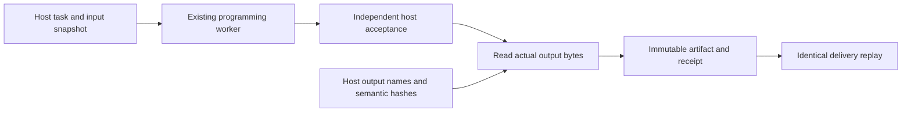

# Accepted work to usable artifacts

An accepted program is not yet a delivered file. The delivery adapter collects
the actual JSON output from its isolated host-check directory, checks it against
an independently enrolled semantic hash, and saves a content-addressed bundle.
It runs no model calls, programs, payments or deployments.



Add a `delivery` object to each enrolled course job. It contains the same
`job_id`, `task_sha256` equal to the canonical identity of the complete task, and
`files`: one to eight objects with a simple `name` and an independently calculated
`semantic_sha256` for the expected JSON value. Output expectations belong to the
host. They are not supplied by the model or inferred from its result.

After the existing work course finishes:

```sh
python -m scripts.collect_program_delivery enrollment.json run/work run/deliveries
```

For new work, run the complete course in one command:

```sh
python -m scripts.run_delivered_course enrollment.json run/work \
  --config reasoning.json --resource-root run/resource-plan
```

This route binds delivery expectations before inference and appends their checks
to the original host checker. A plausible return value with a missing or wrong
artifact is a rejected outcome in persistent memory. The model sees the task
specification; it never receives the appended checks or expected output hashes.
Accepted results are collected automatically. Repeating the same enrolled jobs
reuses both work and delivery receipts without model calls or program execution.
The three comparison methods remain selectable with `--method`; different
methods need separate work journals.

The collector verifies the work journal, exact program, checker, inputs and
accepted outcome. It preserves output bytes and records both their byte hashes
and their JSON semantic hashes. A completed delivery reuses the same receipt
even as later work adds history. Changed bundles, incomplete prior collections,
unsupported worker versions and unknown outcomes stop collection for review.
Existing files are never replaced.

This is a finite local adapter for host-enrolled JSON work. Host checks use the
existing trusted execution semantics; the receipt is not an external attestation
or a proof of generalization. Publication and production activation are separate.
