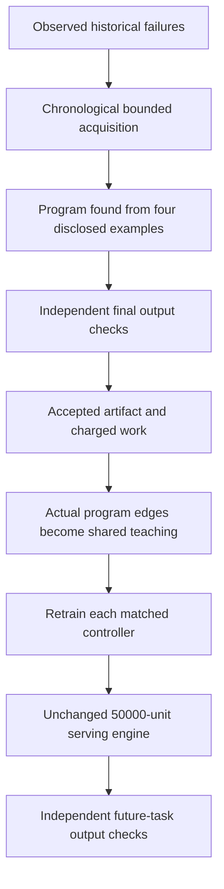

# Acquiring feedback from previously failed tasks

Additional bounded search produced independently accepted programs for
**124 of 128 previously failed training tasks**. After sharing that verified
history with every controller, the unchanged 50,000-unit serving engine
accepted **356/384 tasks with the spiking model**, compared with **350/384 for
nearest neighbors** and **355/384 for the matched continuous model**.

The completed stronger conventional control accepts **382/384 using field-slot
templates**, with two wrong proposals. It uses the same accepted past programs,
disclosed examples and per-task allowance. The spiking model's smaller lead over
nearest neighbors is also uncertain across folds. These comparisons do not
establish neural superiority, and one extra success over the continuous model
supplies no evidence that spiking itself is preferable.

The [complete acquisition summary](../research/neural-routing-loop/development/acquisition-summary.json)
retains selection rules, cohort mappings, full method outcomes, uncertainty and
additional-work accounting. The earlier
[operation-selection study](semantic-operation-selection.md) and its failed
comparisons remain unchanged. No production worker was replaced.

## The question tested

Earlier models learned from the programs that the existing short search could
already solve. Those examples can miss precisely the intermediate operations
needed for harder tasks. This experiment tested whether acquiring verified
feedback on actual past failures improves subsequent decisions at the original
serving allowance.

The acquisition course uses authored, synthetic data-transformation tasks.
It is not paid service delivery, token activity, natural-world interaction or a
new biological experiment. Search actors receive four disclosed examples and
the existing safe program language. They do not receive the generator's hidden
source program as a solution or teaching target.

## Selecting failures and searching deeper

The prior 2,000-task teacher course contains 232 chronological jobs for which
all eight actual search-profile executions failed independent buyer acceptance.
The acquisition protocol selects the first 128 of these, starting with a
10-job pilot and continuing with the next 118. It does not select by task family
or by inspecting the hidden recipe's desired structure.

For each selected job, three fixed routes receive a 500,000-unit search
allowance: default search, slice-first search and the existing spiking-guided
warm search. If no route in that round succeeds, the same routes receive
2,000,000 units each. The complete course records **396 route attempts** and
retains failures as well as successes. Ten pilot jobs and 114 extension jobs
acquire an accepted program; four selected jobs remain unsolved.

These are historical training tasks, so their observed buyer feedback can
inform further acquisition. That is different from serving a future test task:
serving still stops at its first disclosed-example-fitting proposal before the
final buyer check and does not retry using a hidden final target.

Each discovered program must pass the independent 24-row nondiagnostic buyer
check. Its actual accepted abstract syntax tree can then provide operand and
operation-family feedback. A successful job is not necessarily a distinct new
program, and these 124 successes are not 124 newly invented algorithms.

Success in acquisition is shared evidence. Since every controller receives the
same newly verified programs and labels, its existence alone cannot be credited
to the neural ranker used by one acquisition route.

## Preserving the cohort boundary

The source-recipe hash is used only to isolate cohorts and choose the matching
historical model. It is not a model feature, search hint or source-AST label.
Acquisition on source group `g` uses the prior actor trained on that same past
group. New lessons enter only the controller serving the opposite held group.
The future serving group's recipes remain excluded from the acquisition actor
and its training history.

| Future held fold | Acquisition source group | New accepted origins | Records before | Records after |
| ---------------- | -----------------------: | -------------------: | -------------: | ------------: |
| 0                |                        1 |                   57 |         29,152 |        31,160 |
| 1                |                        0 |                   67 |         31,930 |        34,359 |

The separate cohort-mapping addendum records this distinction explicitly. The
acquisition jobs themselves are not claimed to be unseen source groups for
their actors. The controlled question concerns later serving on the excluded
group.

The exact **61,082 earlier records remain as prefixes** of the augmented
training sets. The new accepted history adds 4,437 records, including 469
positives, for 65,519 records and 7,478 positives across both folds. Each model
receives the same permitted records for its fold. No silent truncation or
favorable record selection is used to fit the configured bounds.

The encoder remains the same 130-coordinate operand/operation-family signature.
The objective, learner settings and serving search engine remain unchanged.
The base records come from the earlier operation-edge course; serving uses the
same warm-frontier engine as the intervening development comparison, still
capped at 50,000 interpreter units per task. The altered input is the verified
past history.

## Serving results

Independent output replay reconstructs all **4,608 method deliveries** on the
384 known development tasks. Audit charges are 17,782 units for each method.

| Controller                 | Accepted / 384 | Wrong proposals | Search work | Buyer work |
| -------------------------- | -------------: | --------------: | ----------: | ---------: |
| Trained spiking            |            356 |               1 |   6,384,588 |    240,231 |
| Matched continuous         |            355 |               1 |   6,206,999 |    239,418 |
| Nearest neighbors          |            350 |               1 |   6,141,654 |    232,348 |
| Family-conditioned linear  |            344 |               1 |   6,634,648 |    228,417 |
| Existing strong solver     |            333 |               1 |   6,740,256 |    221,512 |
| Fourier features           |            318 |               1 |   7,334,869 |    208,229 |
| Ordinary linear            |            317 |               1 |   6,611,940 |    208,567 |
| Property priority          |            308 |              15 |   6,073,304 |    211,105 |
| Frozen neural inputs       |            300 |               2 |   6,754,743 |    196,219 |
| Edit similarity            |            297 |               1 |   6,341,921 |    189,806 |
| Full retained-program scan |            261 |               1 |  12,636,083 |    168,677 |
| Size priority              |            222 |               1 |   9,190,892 |    147,670 |

The spiking controller's observed advantage over nearest neighbors is 16 tasks
solved only by spiking versus ten solved only by neighbors: a net six. It gains
ten in the first fold but loses four in the second. The exploratory stratified
source-program-cluster bootstrap interval for the accuracy difference is about
**−1.73 to +4.99 percentage points**, including zero. The paired analysis groups
repeated program rows and preserves the two fixed cohorts; it does not turn
repeated adaptive development into an independent qualification.

The spiking/continuous difference is one success, with all other acceptance
outcomes matching. The experiment therefore supports investigating useful
learned guidance after feedback acquisition, while leaving any spike-specific
benefit unestablished.

## Stronger conventional memory controls

The full retained-program scan is not the strongest conventional memory method.
A larger library can consume its finite allowance before a fallback search.
Two additional controls therefore reuse the same permitted accepted history:

- Short-circuit retention stops checking a candidate as soon as one disclosed
  example mismatches, then spends only the remaining allowance on the existing
  solver.
- Field-slot templates preserve the operations, constants and repeated-field
  relationships of an accepted program while trying legal input-field bindings.
  They generalize a known successful program structure to different field
  positions. Their static preparation uses only accepted ASTs and the fixed
  language configuration.

The implementations were fixed before the full comparison. Both choose their
first four-example-fitting program before a single final buyer check, with no
retry after rejection. Their per-task ceiling remains 50,000 units. The
previous neural and other baseline results are reused as frozen comparisons;
they are not represented as new executions in this validation.

| Additional controller                               | Accepted / 384 | Wrong proposals | Search work | Buyer work |
| --------------------------------------------------- | -------------: | --------------: | ----------: | ---------: |
| Field-slot templates                                |            382 |               2 |   1,450,789 |    262,999 |
| Short-circuit retention                             |            333 |               1 |   8,849,078 |    221,512 |
| Trained spiking checkpoint, fixed during evaluation |            356 |               1 |   6,384,588 |    240,231 |

Each additionally incurs the same 17,782 disclosed audit units. Templates solve
27 tasks the spiking model misses, while spiking solves one that templates
miss. Templates make one additional wrong proposal overall; that tradeoff
remains visible rather than reducing the comparison to a single score.

The [independent control audit](../research/neural-routing-loop/development/semantic-edge-audit-01/memory-controls-independent-audit.json)
rebuilds both prepared caches from the permitted accepted history, reproduces
32 pilot actor calls and their work, and replays all 768 full-run buyer checks
and disclosed-example fits. The caches contain 3,008 distinct bound candidate
ASTs across the two folds. The [complete control results](../research/neural-routing-loop/development/strong-memory-controls-01/full-summary.json)
and [publication manifest](../research/neural-routing-loop/development/archive-manifest-08.json)
retain sources, preparation, failed outputs, costs and evidence identities.

This stronger comparison prevents a neural-superiority claim. The weaker scan's
261 successes cannot establish superiority over conventional memory, and exact
recipe-hash separation does not imply that abstract program templates were
held out. Reusing accepted executable structures is a meaningful procedural
memory capability; this result attributes that benefit to conventional
template reuse rather than neural-specific computation.

## Additional-work accounting

The acquisition and evaluation share one additional 250-million-unit ceiling.
These units measure declared interpreter, candidate and buyer work, not money
or complete hardware FLOPs. Durable reservations prevent an ambiguous result
from silently freeing the reserved allowance. The completed acquisition and
derived-label stages have no unresolved reservation.

| Additional work component                         |           Units |
| ------------------------------------------------- | --------------: |
| Acquisition search and buyer checks               |     129,660,079 |
| Known independent pilot audit                     |          29,916 |
| New lesson derivation, replay and buyer rechecks  |       4,817,523 |
| Known independent feedback audit                  |       3,393,599 |
| Known independent serving output replay           |       2,492,199 |
| Acquisition, derivation and known audits subtotal | **140,393,316** |
| Entire 12-controller serving matrix               |      89,757,480 |
| Combined additional work before stronger controls | **230,150,796** |

The last figure leaves 19,849,204 units before the separate stronger-control
validation. That completed validation records 12,049,126 additional work units,
including preparation, pilot and consistency checks. Of those, the two full
serving actors use 10,819,942 units. Static template/memory preparation records
85,377 units and 2,549,012 serialized bytes; it is included in the validation
total rather than added twice.

The control audit adds another 1,177,011 units, bringing that validation to
13,226,137 units and the combined study to **243,376,933 units**, including the
known independent checks. This remains below the original 250-million-unit
additional-work ceiling, with 6,623,067 units left. Both completed journals
report no unresolved reservation.

The main serving matrix total covers all 12 research branches, not one deployed
agent's consumption. The control validation has a separate finite journal;
its work and audit costs are included in the combined total, not silently
treated as a renewed or free allowance.

The original acquisition/derivation journal and later conservative audit/matrix
reconstruction have distinct boundaries. The later audits are not represented
as entries that existed in the earlier journal. Historical teacher and base
collection costs remain separately retained in the earlier studies and must
also count in a full acquisition-inclusive comparison.

The known independent checks are the itemized study audits. Subsequent package
verification, publication hash scans and repeated reproduction checks are
separate observer work outside these journals. They do not add learning data or
new benchmark outcomes; the table is not an account of every development CPU
operation.

Model fitting, feature extraction, inference, index construction, serialization
and recorded process CPU are additional measurements. The virtual-work subtotal
does not certify end-to-end latency, hosting cost or hardware efficiency. No
paid service, wallet transaction or financial authority was used by this study.

## What remains unproved

This is development on an authored task generator and repeatedly inspected
collections. Group separation protects against a specific source-program leak;
it does not establish transfer to arbitrary useful work or a historically new
AI method. The reserved Duet source bodies remain unopened in this record.

Neither the original 1,024-cell recurrent circuit nor TVB state supplies these
task features. This is a separately trained spiking specialist using verified
program feedback. Its results cannot be attributed to the original circuit,
token trading, fee-funded purchases or biological neurons.

The completed independent checks support the acquired program history and the
stronger conventional template result. A fresh, prospectively fixed evaluation
would still be required for broader generalization claims. The current record
provides accepted-program acquisition and inspectable learning effects, while
conventional templates exceed the neural model's accepted-task count. It does
not establish consciousness, universal superiority or a qualified neural
breakthrough.
