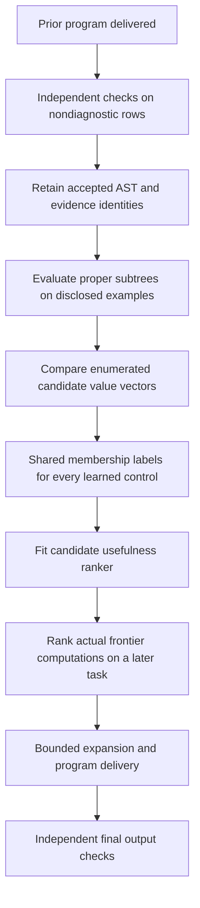

# Learning which computations to expand

Nuria has an experimental spiking ranker that changes which intermediate text
computations a bounded program search expands next. It learns from programs
that already passed independent output checks. **The completed development
comparisons do not establish an improvement over the strongest existing
conventional solver.** No production worker is enrolled in this ranker.

This is a different question from choosing a fixed search profile. A profile
chooses a predefined visitation order. Semantic guidance executes partial
programs, describes their observed values, and scores those computations before
choosing further expansions. A learned score therefore changes actual tool
execution, rather than supplying an annotation after the answer is known.

## What reaches the model

The search receives at most four disclosed input/output examples. Each executed
candidate yields a 100-coordinate property signature:

| Coordinates | Observation                                                                                                                      |
| ----------- | -------------------------------------------------------------------------------------------------------------------------------- |
| 36          | Twelve string properties, each recorded as true for all examples, false for all, or mixed                                        |
| 48          | Sixteen candidate-to-disclosed-target relations with the same three-way encoding                                                 |
| 12          | The candidate's operation category                                                                                               |
| 4           | Bounded structural and length measurements; corrected variants replace the last measurement with mean normalized edit similarity |

Examples of relations are containment, matching after a case change, shared
prefix/suffix and relative length. A candidate's values are compared only with
the disclosed targets. The model receives no task identifier, source recipe,
final buyer target, external token activity or hidden oracle program.

These features are engineered observations. They are not measurements from
the established 1,024-cell Brian2 circuit. The model's hidden cells are a
separate, task-trained spiking specialist, and its development results cannot
be attributed to the recurrent circuit's state or learning.

## How an accepted program becomes feedback

A positive label means that the candidate's observed value vector matches a
proper subtree of an earlier accepted program. The whole solution root is
excluded. A zero label means nonmembership in the observed solution or solution
set; it does **not** prove that the candidate is useless. Other valid programs
can use different intermediate computations.

The first variants included input fields and constants as proper subtree
examples because they are operands available for expansion. A later variant
excluded these leaves and learned only constructed internal expressions. A
separate variant used the union of all independently accepted search-profile
programs for each training task, reducing false negatives from seeing only one
valid solution. Each change is retained as a separate development attempt.

This is supervised binary ranking. It is not the selected-action scalar reward
update used by the [transactional routing policy](neural-routing-loop.md).
Every fitted comparator receives the same feature/label records within its
variant. Job, candidate, program and evidence hashes bind provenance; they are
not numerical model inputs. Those hashes alone do not authenticate an external
buyer. The collection and verification layer must establish the claimed facts.

## The spiking mechanism and controls

[SemanticGuidance](../cognition/semantic_guidance.py) maps a candidate signature
to input currents, runs a bounded leaky integrate-and-fire recurrence, and feeds
hard spike counts to a sigmoid readout. The default configuration has 64 hidden
cells and 16 ticks. Membrane state resets for each candidate; fitted synapses
and readout weights determine subsequent priorities.

Binary cross-entropy training uses a declared bounded surrogate through the
hard threshold. It updates input synapses, hidden biases and readout parameters
with Adam. The surrogate is an engineered training approximation, not an exact
derivative of the spike discontinuity or a biological learning claim.

The matched continuous model trains the same input and readout parameters. The
frozen-input model retains its seeded input synapses and hidden biases, training
only the readout. Conventional controls include logistic regression, fixed
random Fourier features with a learned readout, and nearest neighbors. Property,
edit-distance and size priorities provide nonlearned search controls. All search
controllers use the same registered operations, interpreter, disclosed examples
and finite work allowance within a comparison.

Model fitting is a deterministic full retraining operation. Portable inference
evidence retains architecture, weights, source training-set hash, record/class
counts and optimizer step count. It does not retain Adam moments or promise
mid-minibatch continuation. Restoring inference checks the complete shape,
configuration, finite bounds and frozen/random-feature identities. Receipt
authentication and admission remain responsibilities of a future integration.

## What the development runs show

The course contains 384 authored development tasks in two folds of 187 and 197
tasks. Exact source-program hash groups are kept together. These are not wholly
unseen task-family splits, and repeated design changes make this a development
record rather than a frozen qualification.

Every delivered program is independently checked on nondiagnostic buyer rows.
A program fitting the four disclosed examples can still be wrong. Final buyer
rejection does not authorize trying another answer using the hidden target.

| Variant                    | Spiking | Frozen input | Continuous | Linear | Fourier | Neighbors | Property |         Edit | Existing strong solver |
| -------------------------- | ------: | -----------: | ---------: | -----: | ------: | --------: | -------: | -----------: | ---------------------: |
| Initial                    |     302 |          261 |        300 |    299 |     300 |       280 |      265 | Not measured |          333 reference |
| Corrected shared search    |     313 |          282 |        312 |    319 |     312 |       291 |      289 |          323 |                    333 |
| Union of accepted programs |     317 |          286 |        313 |    301 |     308 |       290 |      289 |          323 |                    333 |
| Internal computations only |     266 |          240 |        266 |    245 |     245 |       254 |      289 |          276 |                    333 |

Entries are accepted deliveries out of 384, not classifier accuracy. The
[complete summary](../research/neural-routing-loop/development/semantic-summary.json)
retains mistakes, deterministic work, CPU measurements, training counts and
artifact hashes. All spiking variants made one wrong proposal. The initial
frozen-input control made two; the union-teacher frozen control also made two.
Coverage, incorrect deliveries and abstentions must remain distinct.

The initial model's apparent first-fold advantage did not survive its second
fold: spiking accepted 160 versus 148 for Fourier features in the first, but
142 versus 152 in the second. Its aggregate gain of two tasks over that learned
comparator is not a robust superiority result. The existing strong solver
accepts 333 tasks, more than every neural variant here.

The initial search also had correctness limitations: first-seen semantic
deduplication could discard a shallower equivalent, and concatenation used
visited-on-enqueue rather than cost relaxation. The corrected search retains
size/depth nondominated representatives and relaxes cheaper concatenation
paths. Its shared 10,000-unit existing-solver prefix and subsequent guided
search share a total 50,000-unit interpreter allowance. This correction is
available to every controller, so it cannot be credited to neural learning.

Training input weights improves several comparisons against frozen weights.
That shows that input plasticity changes behavior in this task-conditioned
model. It does not show that this mechanism is preferable to simpler models:
the edit rule and existing solver remain stronger on these experiments.

## External development check

After fitting on all 384 authored development tasks, the union-teacher model
was evaluated on 43 already-inspected Duet development specifications. Eighteen
unsupported or unscorable specifications remain in the denominator. All learned
and static controls accepted **22/43**, with one wrong proposal. The eight fixed
search profiles at 100,000 units also each accepted 22.

The shared fallback first runs the existing solver with 50,000 units and starts
guided search only if there is no proposal fitting the disclosed examples. Both
stages share 100,000 units. This is not a retry after seeing final buyer failure.
Some final checks are derived from source-authored specification oracles;
they are explicitly distinguished from the original benchmark constraints.

The increased allowance and deeper search therefore demonstrate no additional
competence on this external development set. The 162 reserved specification
bodies remain unopened in this record. A prospective source/protocol freeze
and independent reserved evaluation would be necessary before claiming
generalization.

## Accounting and independent checks

The interpreter allowance is not total computation. Search records separately
measure signature extraction, scoring and complete search CPU. Model fitting,
teacher-history execution/collection and buyer verification add further work.
The summary's search/fit/buyer CPU sum explicitly excludes teacher collection,
input loading, setup and bookkeeping. It is not end-to-end wall-clock latency,
and no hardware-efficiency superiority is established.

The independent [semantic verifier](../scripts/verify_semantic_guidance.py)
imports no fitted semantic scorer. It maps a sigmoid readout into the separate
tanh reference using `sigmoid(z) = (1 + tanh(z / 2)) / 2`, preserving the original
LIF currents and spike counts. A Brian2 network independently reproduces the
threshold/reset execution. For the retained first eight checked observations,
the trained model emits 3,084 spikes and the frozen-input control 2,153; the
continuous control correctly reports zero spikes.

This verifies numerical execution and binds the published evidence,
configuration, observations and optional supplied training records. It does not
authenticate external receipts, prove that fitting followed a claimed history,
establish a useful-task advantage or demonstrate consciousness.

Learned priorities for executed intermediate programs are established prior
art in [BUSTLE](https://github.com/google-research/google-research/tree/master/bustle)
and [its paper](https://arxiv.org/abs/2007.14381). These experiments independently
apply that general approach to a bounded safe text language and spiking ranker;
they are not a claim to have invented learned program search.

## Integration status

The numerical ranker, inference restoration and independent verifier exist.
The semantic search remains an experimental development implementation. It is
not enrolled in the existing producer, task admission, commerce worker or
financial execution path. The original recurrent neural history remains
unchanged, and this work supplies no spending or signing authority.

The retained original artifact hashes identify each attempt. The
[archive manifest](../research/neural-routing-loop/development/archive-manifest-03.json)
binds compressed and path-normalized copies separately. The
[independent delivery replay](../research/neural-routing-loop/development/semantic-independent-deliveries-03.json)
reconstructs all 14,592 authored deliveries, final acceptance, buyer work and
summary arithmetic. It checks archived bytes and compressed content privacy,
but does not reconstruct search visitation, gradient updates, timing or external
receipt authenticity. None of the completed variants is a release qualification
or a demonstrated neural-superiority result.
