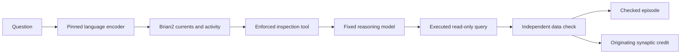

# Semantic observations and delayed neural credit

`SemanticNeuralBridge` is an optional, separate Brian2 laboratory. Its input is a
fixed language representation of the actual question, rather than random texture
made from a job or source identity. The circuit can choose a registered first tool;
the analyst host enforces that choice. A later independently checked outcome can
credit the originating neural trace.

This route is implemented and tested with explicit unit fixtures. A retained
pretrained-encoder probe also demonstrates real semantic vectors reaching actual
Brian2 sensors. It has not yet demonstrated better useful decisions than a strong
controller given the same representation. It is not enabled in the public app.

## What reaches the circuit

The [encoder](semantic-encoder.md) observes the supplied question alone before the
first inspection. The host also supplies statistics derived from actual observed
tool outcomes and costs. These are not a license to inspect schemas, rows, labels
or future receipts without executing their registered tools. Later observations
require their own earned tool receipt and a matching budget in every control.

The 384-dimensional vector passes through a fixed 64-dimensional projection into
128 signed sensory channels and 64 memory features. Salience and energy are
constant. Job IDs, source hashes, model identities and policy hashes remain in
receipt and recovery metadata; they never enter embedding text, sensory current,
utility estimates or the projection seed. Changing only those identities must
leave the semantic drive unchanged.

## Two Python runtimes

The optional CPU packages need not be installed in the Brian2 runtime. A
`OneShotSemanticEncoder` launches one explicitly configured CPU interpreter per
observation. The command uses isolated Python mode, an exact reviewed worker-file
identity and no shell. Question JSON travels through stdin, never command-line
arguments. The child receives a small environment without inherited provider
credentials, `PYTHONPATH` or user-site packages.

The worker uses two intra-op threads, one inter-op thread and the CPU provider.
It accepts at most 5,000 UTF-8 question bytes and 256 wordpieces, refuses silent
truncation, and has a maximum 30-second process allowance. Stdin, stdout and stderr
are bounded. Failure terminates the worker's own process group, including a
remaining descendant after its leader exits. The parent independently checks the
vector, input identity, weight/tokenizer binding, byte and token counts, call
count and receipt checksum. Host-configured paths are not model tools.

The source manifest pins the optional package versions and model artifacts. These
checks establish local provenance, not external attestation of a model service.
Weights and private observations are provisioned outside Git. The test suite
imports these modules without ONNX Runtime or a live inference session.

## Host integration

The calling host owns source enrollment, finite job budgets and terminal checking.
A typical sequence is:

```python
from cognition.semantic_worker import OneShotSemanticEncoder
from cognition.semantic_neural import SemanticNeuralBridge

encoder = OneShotSemanticEncoder(
    configured_cpu_python,
    private_model_directory,
    semantic_manifest,
    max_calls=reviewed_encode_allowance,
    timeout_seconds=30,
    worker_sha256=reviewed_worker_sha256,
)
bridge = SemanticNeuralBridge(
    private_new_lab,
    source_id=enrolled_source_revision,
    model_id=analyst_model_identity,
    tool_version=enrolled_tool_version,
    encoder=encoder,
)
try:
    decision = bridge.choose(job_id, context_sha256, question, observed_tool_stats)
    # GroundedAnalyst receives initial_tool=decision["first_tool"] and a bounded
    # neural_context. Its existing host action enforces the first tool.
    # Only after that analyst's proposal, actual query receipt and host checker
    # agree may the host settle memory and credit this originating decision.
finally:
    bridge.close()
```

The code does not add a model-controlled grading action. A completion, a valid SQL
query or an agent's own claim of success is insufficient terminal evidence.
Production hosts must bind the independent checker to the exact source, proposal,
query receipt and job before invoking `settle(job_id, accepted, evidence_sha256)`.
The bridge API accepts the host's verified outcome; it does not independently
prove that an arbitrary caller is a trustworthy checker.

## Persistence, ambiguity and delayed outcomes

The bridge composes the existing capsule store and preserves its lock, immutable
checkpoint chain, neural state and RNG recovery. A separate `SEMANTIC.json`
identity binds the source, analyst model, tool contract, encoder, projection and
implementation. A changed identity refuses an existing history. Checkpoints are
trusted local state, not untrusted downloadable inputs.

Before an encoding disclosure, the bridge durably records `embedding_reserved`.
If the process or encoder fails, that reservation survives reopening. Any new
choice is refused until explicit reconciliation; a restart does not grant an
implicit retry or another encoding allowance. The encoder's in-memory call count
is an additional bound, not a durable budget. A completed duplicate job returns
its original decision without another encoding.

The laboratory is deliberately finite: 128 jobs, 64 unsettled decisions and the
inherited bounded capsule history. It is not an unbounded production job queue.
The host must schedule a new reviewed experiment rather than silently exceeding
those limits. The originating action's eligibility trace is saved at decision
time, so an outcome arriving after another question still updates the original
trace once. Repeated matching settlements are idempotent; a contradictory outcome
is refused.

## Evidence and next comparison

[Full wiring evidence](../research/semantic-input/README.md) includes all twelve
predeclared texts, pretrained vectors and observation receipts, plus four actual
100 ms Brian2 windows restored from one checkpoint and RNG state. The captured
prototype and hardened wrapper have distinct source identities. Stored-vector
checks reproduce the numerical current mapping without another encoding call.
Unit tests separately verify first-tool enforcement, recovery, metadata
invariance, delayed credit and durable refusal after interruption.

An [actual integration trial](../research/hybrid-agent/work-trials/README.md)
also answered a question about 40 recorded work
tasks. The enforced neural inspection led to an executed query whose answer
matched a separate grouping of the retained JSON. Its linked terminal credited
205 originating tagged synapses once. The trial used one CPU encoding and 3,499
completion tokens. It retained a checked episode and no qualified reusable
procedure. This is a working closed loop for one case, not a comparison result or
retroactive semantic acceptance of the 40 underlying tasks. Those source records
still have unknown semantic acceptance. The pretrained model's weights did not
change.

The separate [numeric witness](../research/hybrid-agent/weight-delta/README.md)
checks all 22,920 excitatory weights. Exactly 205 changed at the saved originating
indices; the full after-array matches the bounded reward equation exactly, and
the other projected variables remain unchanged. Safe numeric exports reproduce
both original projected-state hashes. Their derivation from trusted local
checkpoints is disclosed. Portable checking neither unpickles nor reruns neural
dynamics, and the update does not itself establish a future decision benefit.



The next useful-task comparison must enroll fresh tasks before inspection and
freeze representation, observations, feedback, outcome checker and resource
budgets across all arms. The primary conventional control should use the same
384-dimensional embeddings in a regularized contextual selector, alongside a
schema-first heuristic. The [implemented LinUCB control](semantic-control.md)
provides that conventional selection and delayed-outcome path; its useful-task
performance is still unmeasured. A lexical selector tests whether the language encoder is
necessary. Frozen-state neural, shuffled-embedding and old identity-texture arms
separate feedback learning, meaningful input and identity memorization. Pair
initial states and order; count every enrolled task and unresolved liability.

Measure independent answer acceptance, tool cost, latency, calibration and retained
performance on unseen paraphrases, schemas and source identities. Report neural
advantage only if it exceeds the same-representation controller under those
conditions. The encoder's prior language competence must never be attributed to
new learning in Brian2.

## Run one question

The optional command uses an already running loopback reasoning service and an
explicitly provisioned CPU runtime. It creates neither service nor wallet:

```sh
python -m scripts.ask_semantic_analyst \
  --registry /private/source/registry.json \
  --state /private/semantic-analysis \
  --model-identity exact-model-revision \
  --job-id a-new-reviewed-job \
  --db-id enrolled-database \
  --question 'What is the total observed amount?' \
  --cpu-python /private/encoder-runtime/bin/python \
  --model-directory /private/encoder-model \
  --semantic-manifest research/semantic-input/runtime/model-manifest.json \
  --worker-sha256 reviewed-worker-file-sha256
```

The host must check cumulative encoding, generation and wall allowances before
launching the command. It reserves one CPU observation and at most 6,000 completion
tokens before either request, then stores its decision, full analyst trace,
executed SQL receipt and usage privately. `semantic_accepted` remains `null` and
`neural_credited` remains `false`; a separate host checker must bind a later
terminal to those exact records. A duplicate or interrupted job never silently
repeats an encoding or reasoning request. This finite command does not configure
continuous operation or authorize future experiments.

The circuit's trace-based updates build on Brian2's explicit synaptic state and
[event-driven STDP primitives](https://brian2.readthedocs.io/en/stable/examples/synapses.STDP.html).
Those mechanisms make an update inspectable; their existence does not establish
that a particular useful outcome was caused by that neural choice.
