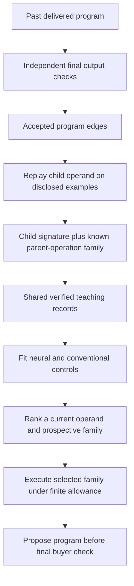

# Choosing an operation before executing it

Jointly learning an operand and its next operation did not produce a useful
neural advantage in this development study. The spiking controller accepted
**316/384 tasks with two wrong proposals**. The existing solver and a
nearest-neighbor controller each accepted **333/384 with one wrong proposal**.
A conventional family-conditioned linear model accepted 322 with one wrong
proposal. The negative comparison remains part of the research record.

This experiment changes the decision being learned. Earlier
[semantic-priority variants](semantic-guidance.md) scored a computation after
executing it, while each selected operand still expanded operation families in
a fixed order. Here the controller scores an **existing operand plus a
prospective operation family**. Its priority changes which family is actually
executed next. That makes the model's decision consequential, but the results
still need to justify using it.

The [operation summary](../research/neural-routing-loop/development/operation-summary.json)
binds the completed results, source audits, accounting supplement and exact
conventional-control reruns. The [publication archive](../research/neural-routing-loop/development/archive-manifest-05.json)
retains the original slow runs as well as the separately recorded optimized reruns. No production worker,
site presentation, neural history or financial authority changed.

## The observation boundary

Each legal action has 130 normalized coordinates, identical for the neural and
conventional fitted controls:

| Coordinates | Information available before execution                                                                                                                        |
| ----------- | ------------------------------------------------------------------------------------------------------------------------------------------------------------- |
| 0–99        | The retained 100-coordinate operand signature: string properties, disclosed-target relations, operand operation, bounded structure/length and edit similarity |
| 100–117     | Six directional case-insensitive containment/prefix/suffix relations, each encoded as all, none or mixed across disclosed examples                            |
| 118–129     | A one-hot code for the prospective operation family                                                                                                           |

There are nine legal unary expansion families: stripping whitespace, uppercase,
lowercase, other case operations, token extraction, splitting, slicing,
replacement and numeric formatting. The 12-category one-hot schema also retains
field, constant and concatenation categories. Fields/constants are operands,
and concatenation remains a shared fixed shortest-path composition pass rather
than a learned action in this study.

The controller sees only already-computed operand values and at most four
disclosed input/output examples. It does not see the new parent's output before
choosing its operation. Task identifiers, generator recipes, undisclosed buyer
targets and the established 1,024-cell recurrent circuit's state are absent
from numerical model inputs.

## Learning from successful past edges

After a prior whole program passes independent checks, its actual parent/child
edges can supply teaching. For example, an accepted `upper(token(field))`
program supplies evidence about extracting a token from the field and changing
the resulting token's case. A root-parent edge is a legitimate past label: the
child's pre-operation values are observed, while the computed root result is
excluded from the learner's features.

Missing teacher operands are materialized by replaying children of the actual
accepted program. This work is recorded separately. The method does not use the
hidden generator recipe as a target program. Conditional teachers outside this
experimental grammar are explicitly rejected rather than partially traversed.

Positive labels describe observed successful operand/family edges. A negative
label means nonmembership in the accepted programs observed for that origin;
it is weak evidence, not proof that the operation is universally useless. All
fitted controls receive the same records and prior history.

The collection contains **61,082 records, including 7,009 positives**, across two
folds. Independent source audits reconstructed all records and replayed **8,759
accepted program executions** before teaching. These executions are not 8,759
unique programs or independent natural-world experiences; they come from 1,768
successful origins in the prior 2,000-task synthetic teacher course.

## Group separation and controls

The 384 known authored development tasks are split into folds of 187 and 197.
For each fold, the prior teacher subset excludes matching source-program recipe
hash groups. The first fold's training subset contains 937 teacher jobs, 825
accepted origins and 29,152 records; the second contains 1,063 teacher jobs, 943
accepted origins and 31,930 records. The retained audits confirm zero exact
source-program group overlap for either train/test comparison.

Recipe hashes determine separation and are absent from model inputs. This is
stronger than simply splitting rows from the same program, but it is still
development on known task families and a repeatedly inspected course. It is
not a fresh qualification. The 162 reserved Duet specification bodies remain
unopened in this record.

Controls include the matched continuous and frozen-input models, ordinary
linear, Fourier and nearest-neighbor rankers, property/edit/size priorities,
the existing solver and whole-program retention from each permitted prior
history. A family-conditioned linear comparator uses the same 130 raw
coordinates: the known operation family selects one affine model over the
118-coordinate operand context. Its 1,428 parameters supply an explicit
conventional operand/family interaction rather than denying that interaction to
all simpler models.

## Accepted deliveries and mistakes

Every controller operates under the same 50,000-unit per-task search ceiling.
Guided search uses a shared existing-solver prefix and only the remaining
allowance for selected expansions; the standalone existing solver receives the
full allowance. Diagnostic fit selects a proposal before final output checking.
Buyer rejection does not authorize a hidden-target-guided retry.

| Controller                | Accepted / 384 | Wrong proposals | Search work | Buyer work |
| ------------------------- | -------------: | --------------: | ----------: | ---------: |
| Existing strong solver    |            333 |               1 |   6,740,256 |    221,512 |
| Nearest neighbors         |            333 |               1 |   6,674,588 |    223,096 |
| Retained whole programs   |            327 |               1 |  10,927,563 |    216,537 |
| Family-conditioned linear |            322 |               1 |   7,053,235 |    216,739 |
| Matched continuous        |            321 |               1 |   7,439,898 |    216,187 |
| Trained spiking           |            316 |               2 |   7,503,096 |    212,938 |
| Fourier features          |            316 |               1 |   7,378,637 |    208,592 |
| Ordinary linear           |            312 |               1 |   6,767,757 |    205,090 |
| Edit similarity           |            301 |               1 |   6,613,783 |    192,428 |
| Frozen neural inputs      |            290 |               3 |   7,324,453 |    188,334 |
| Property priority         |            277 |              15 |   7,323,160 |    180,709 |
| Size priority             |            222 |               1 |   9,608,592 |    147,670 |

Each row additionally incurs the same 17,782 diagnostic audit work units.
Acceptances, mistakes and abstentions are separate outcomes. The spiking model
improves on frozen input weights, but it does not beat the continuous,
family-conditioned linear, nearest-neighbor or existing-solver alternatives.
Beating only ordinary linear would omit stronger controls that use the same
available information.

## Full acquisition accounting

The accounting supplement retains these distinct work components across both
folds:

| Component                                               |  Work units |
| ------------------------------------------------------- | ----------: |
| Historical eight-profile teacher search                 | 467,003,223 |
| Historical teacher buyer checks                         |   6,141,551 |
| Current common exploratory search                       |  30,018,636 |
| Proper operand/edge replay and materialization          |     299,876 |
| Repeated independent buyer verification before teaching |   5,720,367 |

Together these are 509,183,653 recorded acquisition work units, before model
fitting and evaluation searches. They are not dollars or hardware instruction
counts. An acquisition-inclusive efficiency comparison must retain them rather
than treating replayed operands or successful program history as free.

The summed historical per-job teacher process CPU is about 192.68 seconds.
Current collection CPU is about 113.51 seconds and already includes exploration,
operand replay, buyer rechecks and serialization. Independent audit CPU must
not be added again as if it were original training work. Model fitting,
per-task signature/scoring/search, buyer checking and index startup are recorded
separately. No acquisition-inclusive neural efficiency advantage is established.

## Exact nearest-neighbor engineering

The conventional nearest-neighbor control initially spent most of its time
rescanning repeated property signatures. All original slow runs completed and
remain retained. A separately audited exact index groups identical binary
coordinates while preserving the original distance, selected neighbors,
tie order and class-balanced scoring rule. It does not substitute approximate
neighbors or change the teaching data.

Complete indexed reruns of both folds reproduce the original programs,
statuses, search counters, observations counts and buyer outcomes. The indexed
traces append explicit index instrumentation; those new fields are not claimed
to exist in the originals. All shared non-CPU outcome fields match.

The [complete two-fold receipt](../research/neural-routing-loop/development/semantic-knn-exact-01/full-both-folds-exact-replay.json)
records **1,064.652717 seconds of original search CPU versus 42.821022 seconds
for the indexed reruns**, a measured local ratio of about **24.86×** across
384 tasks. The result remains 333 accepted and one wrong. This is a useful
conventional implementation optimization, not neural learning evidence or a
general product-latency claim.

Index startup is separate: about 0.060 seconds for fold zero and 0.062 seconds
for fold one. Reported index arrays occupy 348,786 and 366,786 bytes respectively.
These are auxiliary index bytes, not the full model's memory. The first fold
also retains 30,318,080 feature-array bytes and 233,216 label-array bytes. Its
total owned NumPy arrays therefore occupy 30,900,082 bytes, including the index.
This excludes Python objects, prediction-cache entries, temporary allocations
and process RSS. Process memory and acquisition costs are not replaced by the
smaller auxiliary figure.

## What independent spike checks establish

Separate Brian2 networks reproduce the trained/frozen hidden spike counts and
the independent sigmoid readout mapping. For the first eight checked
observations in each fold:

| Mechanism          | Fold zero spikes | Fold one spikes |
| ------------------ | ---------------: | --------------: |
| Trained spiking    |            2,911 |           3,585 |
| Frozen inputs      |            2,027 |           2,340 |
| Continuous control |                0 |               0 |

The retained receipts bind configuration, weights, observations and training
identities. This checks the simulated numerical execution; it is not physical
neural hardware, consciousness evidence or a performance improvement. A correct
spike implementation can still make worse useful decisions than a conventional
agent, as this comparison shows.

The completed study therefore answers a bounded mechanism question: choosing
the operation family before execution makes the neural decision operationally
real, but this implementation still does not justify replacing the stronger
existing solver. No later experiment's result is assumed by this record.
