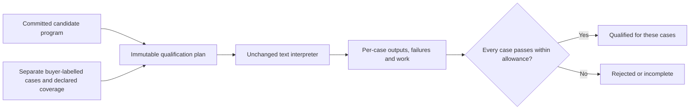

# Qualifying a reusable skill

A program can match four examples and still implement the wrong rule. In the
text-abstraction study, a program that retained two words passed rows whose first
segment always contained two words. It failed when that segment contained three.

The optional [qualification gate](../cognition/skill_qualification.py) separates
an example-fitting proposal from evidence of reuse on a declared set of cases.
It does not change the live worker or automatically admit programs to its library.

## A committed proposal and a separate plan

The caller supplies a program, its original diagnostic inputs, a source identity,
a domain description and independently labelled challenge cases. Each case has
an expected output and explicit coverage labels. The caller also declares the
minimum passing count for each label. The gate checks that the plan contains
enough distinct cases for those requirements.

Inputs are canonicalized as field arrays. JSON formatting and escape sequences
cannot hide repeated inputs or overlap with the original diagnostic inputs. The
prepared immutable plan binds the program, language configuration, source, domain,
diagnostic-input commitment, challenge cases and coverage requirements.

The caller authenticates the buyer, commits the proposal before obtaining fresh
labels, and decides whether the cases cover a useful domain. The gate does not
authenticate external identities or independently validate the meaning of a
coverage label. A plan constructed from already revealed examples is a diagnostic,
not an untouched qualification.

## What a result means

Execution uses one hard work allowance across the entire plan. Serialized plan
bytes, interpreter operations and output comparisons are charged. Plan validation
and hashing are bounded host work outside this declared virtual meter; it is not
a measure of complete CPU, energy or hosting cost.

A failed case stays failed even if later rows pass. An invalid interpreter input
is a failure. Exhaustion remains incomplete, including when every completed row
was correct. Qualification requires every planned row and the declared passing
coverage. Missing or malformed plans raise an error rather than produce success.

The receipt records the plan and program identities, per-case outputs and errors,
passing coverage and work. Its hash helps identify the evidence. It is not a
signature, a payment authorization or a portable admission credential. It proves
agreement with the supplied finite labels, not universal correctness for the
named domain.

## Retained diagnostic

The [published study](../research/text-abstractions/README.md) applies the gate to
previously committed programs using the already revealed broader-input challenge.
No controller is retrained and no original score is rewritten. All **183 learned
proposal instances** are rejected on that broader set; all **64 reference-program positive
controls** pass their respective 32 cases. The controls use the known reference
programs and are not learned successes.

This is a repair to evidence handling. The text learner still needs to acquire
programs that pass meaningful new cases, and the neural component still needs to
outperform its simpler comparators before a decision advantage can be claimed.
