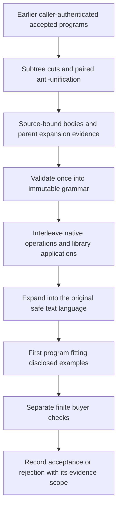

# Reusable text subprograms

The text learner can extract parameterized subprograms from earlier accepted
programs and compose them with ordinary text operations. Every resulting program
still belongs to the existing `safe-text-v1` language. The library changes the
search routes available under a finite allowance; it adds no filesystem,
network, process or wallet operation.

The completed development comparison supports a narrow result: conventional
relatedness ordering accepted **24/64** authored tasks, versus **16/64** for
whole-program template reuse and **16/64** for spiking guidance. A subsequent
broader-input challenge covered **all 64 tasks and all 11 methods**: no delivered
program matched every challenge row. Expanded historical teaching and a shared
work-fair scheduler also failed to establish a neural advantage.

The [research record](../research/text-abstractions/README.md) retains the methods,
failed comparisons and replay evidence. This component is not enrolled in the
live worker, and the site design is unchanged.

## From accepted programs to a library

The [extractor](../cognition/text_abstractions.py) receives bounded records
containing a native program, its hash, an originating-job hash and an evidence
hash. The caller must authenticate the earlier buyer acceptance. The extractor
checks record structure and identity; a matching hash alone does not authenticate
a buyer or establish that the buyer's examples covered every relevant input.

Extraction visits whole expressions and their subtrees. It uses three related
operations:

- Canonical holes replace varying text expressions while preserving shared
  operation structure.
- Explicit cuts replace one or two selected **proper subtrees** with holes.
  Repeated occurrences of the same subtree share an argument.
- Paired anti-unification compares subtrees from distinct parent programs,
  retaining shared operators and literal parameters while replacing differing
  expressions with canonical holes. Repeated paired differences share a hole.

For example, a retained body can represent
`upper(token(HOLE_0, pattern="word", index=0))`. A new application may supply a
field expression or another valid text expression for `HOLE_0`. The token pattern
and position remain literal. Conditional field selectors likewise remain literal;
they do not become arbitrary executable parameters.

An emitted abstraction has one to three text-expression arguments, preserves at
least two fixed native operation nodes and carries support from at least two
distinct parent-program hashes and originating jobs. Its support records retain
the parent program, subtree path, argument bindings and hashes. Validation
reconstructs the supported native subtrees exactly. This demonstrates structural
provenance, not universal correctness of a newly combined application.

Generation, candidate patterns, pairs, support records and output-library size
have explicit bounds. Exhaustion and partial extraction remain visible. Node and
byte compression are recorded for the definition and bindings; compression is an
ordering heuristic, not demonstrated future utility or a hardware saving.

## Immutable preparation and native execution

Preparation checks the source identity, language configuration, support paths,
parent hashes and reconstructed expansions. The resulting immutable in-memory
objects retain canonical bodies and configuration data, rather than mutable
references to input records. They are not an authority format for untrusted
object deserialization.

Every application validates its argument expressions and expands the body into
an ordinary native abstract syntax tree. The expanded tree must satisfy the
original node, depth, field and operation limits. Hole markers never reach the
interpreter. Repeated use of an abstraction does not turn its body into a
single cheap primitive: construction and expanded validation have declared
costs, and the unchanged interpreter separately executes and charges the native
operations.

Mining, preparation, serving work, buyer checks, serialized storage and measured
CPU have different boundaries. The declared work counters are not a complete
account of helper hashing, hardware instructions, energy or hosting cost.

## Search and matched controls

The [search engine](../cognition/abstraction_search.py) maintains a bounded
frontier of executed partial expressions. Native unary operations and joins are
interleaved with library applications. A multi-argument application binds at
least one argument to the current expression and draws other arguments from a
bounded observed beam. Each frontier turn yields after one invocation. The
current work-fair scheduler also reduces a state's priority as its charged work
grows and uses a 750-unit slice for concatenation frontier exploration. Candidate
execution remains subject to the complete search allowance. The earlier 64-task
matrix used the retained legacy schedule; later pilot results below are reported
separately.

Conventional relatedness, support frequency, uniform ordering and learned
rankers change visitation order. Relatedness uses the partial expression's
observed relationship to disclosed targets. The learned spiking, frozen-input,
continuous, linear and nearest-neighbor branches use the same permitted
partial-observation interface and prepared library. The models remain frozen
during the completed 64-task serving comparison.

Native-only controls use the same active engine with library applications
switched off. The [whole-program template comparator](../cognition/template_reuse.py)
rebinds fields in retained complete programs and may use the unchanged
composition fallback. All methods produce programs in the same interpreter
language and receive the same 50,000-unit per-task search ceiling. They do not
have identical visitation schedules or exhaustive coverage of that language.

Equal values on disclosed examples may share a search representative. That
pruning and the argument beam are deliberately incomplete. Two expressions
agreeing on the available examples can disagree later. Search commits its first
disclosed fit before the separate buyer evaluation; a rejected final target does
not become a repair hint or authorize another scoring attempt.

## Completed development results

`development64-summary.json` records the following accepted-task counts. Each
accepted proposal matched all **24 original buyer rows** for that task; every
listed method had zero wrong submitted proposals on those original rows.
Abstentions and work-limit failures remain in the 64-task denominator.

| Method                               | Accepted / 64 | Wrong proposals on original rows |
| ------------------------------------ | ------------: | -------------------------------: |
| Native plus conventional relatedness |            24 |                                0 |
| Nearest-neighbor guidance            |            23 |                                0 |
| Linear guidance                      |            18 |                                0 |
| Whole-program field templates        |            16 |                                0 |
| Spiking guidance                     |            16 |                                0 |
| Frozen neural inputs                 |            16 |                                0 |
| Matched continuous guidance          |            16 |                                0 |
| Native plus support frequency        |            16 |                                0 |
| Native plus uniform ordering         |            16 |                                0 |
| Native-only relatedness              |             0 |                                0 |
| Native-only spiking guidance         |             0 |                                0 |

The 64 instances come from **eight known authored structural clusters**. The
eight earlier pilot instances had already informed implementation revisions.
They are not 64 independent structural observations, customer requests, an external
benchmark or a reserved qualification. A recorded pre-run source/model freeze
does not undo that prior development exposure.

On this course, library applications with conventional relatedness ordering
increase original-row acceptance over whole-program reuse and the same native
engine without abstractions. The result attributes that observed gain to the
library/search combination. It does not attribute the gain to neural ranking:
spiking, frozen-input and continuous guidance tie, while the conventional
relatedness and nearest-neighbor branches solve more tasks.

## What the broader-input challenge found

The full `posthoc64-string-challenge-audit.json` replays the committed programs
for **all 64 tasks across all 11 methods**, using 32 new valid inputs per task.
Inputs vary segment and word counts, case, digits and whitespace while retaining
the task's delimiter. Targets come from the fixed ordinary-Python reference
rules. Every method receives the same challenge inputs for a given task.

| Method                               | Submitted proposals / 64 | Exact on all 32 challenge rows |
| ------------------------------------ | -----------------------: | -----------------------------: |
| Whole-program field templates        |                       16 |                              0 |
| Native plus conventional relatedness |                       24 |                              0 |
| Native plus support frequency        |                       16 |                              0 |
| Native plus uniform ordering         |                       16 |                              0 |
| Spiking guidance                     |                       16 |                              0 |
| Frozen neural inputs                 |                       16 |                              0 |
| Matched continuous guidance          |                       16 |                              0 |
| Linear guidance                      |                       18 |                              0 |
| Nearest-neighbor guidance            |                       23 |                              0 |
| Native-only relatedness              |                        0 |                              0 |
| Native-only spiking guidance         |                        0 |                              0 |

Every submitted proposal failed at least one broader challenge row. Abstentions
are recorded separately and are not counted as incorrect submitted programs.
Original buyer scores remain unchanged: this is a post-hoc distribution-shift
diagnostic, not an untouched qualification or an additional training source.

One concrete distinction is a program that uppercases the first two words versus
a reference rule that uppercases the whole first delimiter segment. The original
authored rows always placed two words there, so both rules passed. A longer first
segment distinguishes them. The narrow acceptance gain therefore does not
establish useful semantic transfer across this broader input domain.

## Follow-up teaching and scheduling

The first teaching set overrepresented raw fields and lacked positive examples
for several intermediate operations. A follow-up replay traversed proper
subprograms in the same earlier accepted programs and wrapped them in bounded
text contexts. This produced **21,386 labelled observations**, including **4,163
positive observations**, and 1,142 imagined program candidates. These are
mathematical replays of historical programs, not new customer deliveries. The
whole-program control also received the imagined candidates.

On the same eight development tasks, expanded-context spiking guidance accepted
**0/8**, versus **3/8** for frozen neural inputs and **3/8** for the smaller-first
imagined-template control. A historical-coverage-only spiking fit accepted
**1/8**. More teaching coverage did not produce an observed neural advantage.

A subsequent pilot applied the same work-fair scheduler to every method:

| Work-fair method          | Accepted / 8 |
| ------------------------- | -----------: |
| Conventional relatedness  |            3 |
| Frozen neural inputs      |            3 |
| Linear guidance           |            3 |
| Original spiking fit      |            2 |
| Historical-coverage fit   |            2 |
| Expanded-context spiking  |            2 |
| Matched continuous model  |            2 |
| Nearest-neighbor guidance |            2 |
| Uniform ordering          |            2 |
| Support frequency         |            1 |
| Native-only spiking       |            0 |

Independent replay verified all **88** work-fair deliveries and their recorded
buyer costs. Every spiking success was also a relatedness success. No
concatenation slice reached its 750-unit allowance in this pilot, so it supplies
no empirical evidence for the slice-yield mechanism's benefit. Every proposed
program again failed the fixed broader-input challenge.

These follow-ups reused eight previously inspected cases. They diagnose failed
approaches and planner behaviour; they do not provide fresh qualification or a
neural-superiority result.

## Relation to established library learning

Learning reusable program abstractions and guiding synthesis with learned
recognition models are established approaches. [DreamCoder](https://arxiv.org/abs/2006.08381)
combines symbolic library growth with neural search guidance through wake-sleep
program learning. [Stitch](https://arxiv.org/abs/2211.16605) develops corpus-guided
top-down synthesis for learning shared library functions; its
[official implementation](https://github.com/mlb2251/stitch) accompanies that work.

This bounded text implementation uses explicit subtree cuts and paired
anti-unification with source-bound expansion evidence. It is not a reproduction
of either complete system, a new library-learning principle, a consciousness
result or evidence that spiking computation is superior.
