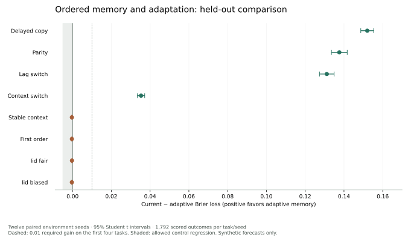

# Adaptive outcome memory

The earlier TVB/Brian2 integration changed spikes but did not establish a useful
forecasting improvement. This follow-up addresses the forecast path: explicit
ordered memory and adaptation when a previously useful rule changes.

## Diagnosis

The [trace replay](diagnosis.json) exactly reconstructs the original council.
On delayed dependency, removing its neural expert increases Brier loss from
0.211862 to 0.231537. Existing neural activity carries useful information.
However, adding TVB changes the neural probability by only 0.00136 on average.
On reversal, that change is 0.00174 and the council probability changes by only
0.00000821. The context logistic specialist scores 0.225992 while the complete
council scores 0.250921: selecting and adapting the predictors matters.

The council has no explicit ordered sequence buffer. Its conditional counts
have a 693-input half-life, while the original reversal leaves only 80 inputs
under the new rule. TVB's structural weights and engineering ports do not learn
an outcome-dependent representation. These observations identify plausible
bottlenecks; they do not assign every failure to one cause.

## Candidate

The original neural/statistical council remains a specialist and initially owns
90% of the new mixture. Other specialists learn lagged relations, suffixes up to
eight events and contextual transitions. Each has slow and fast outcome counts.
Online likelihood weighting keeps useful predictors available after a shift.
The buffer holds 16 observed sides, and each count bank has at most 1,024 cells.

Labels update only the keys and probabilities retained before that label
arrived. Each source owns a separate instance. Checkpoints retain pending
forecasts, counts, mixture weights, ordered history and the original council.
Migration preserves the old parameters and metrics; the new method starts its
own evaluation history at its actual first input.

The implementation is a bounded statistical memory component. It is distinct
from Brian2 plastic synapses and TVB regional connectivity. Variable-order
prediction is established work; this is not a claim of a new CTW algorithm or
its theoretical guarantees. See [Begleiter, El-Yaniv and Yona, 2004](https://arxiv.org/abs/1107.0051)
and [Willems, Shtarkov and Tjalkens, 1995](https://doi.org/10.1109/18.382012).

## Fixed comparison

The [protocol](protocol.json) is byte-frozen by [its digest](protocol.sha256).
[Implementation hashes](implementation.json) are committed before validation.
Development uses three seeds; validation reserves twelve different seeds.
Every task scores 1,792 outcomes after the same 256-transition warm-up.

Eight families cover delayed relations, parity, changing lag rules, changing
amount/fee rules, stable contexts, first-order transitions and independent fair
or biased inputs. Comparators include the old council, sequence/fast-memory
ablations, frozen learning, a learned lag-only mixture and suffix-only backoff.
Neither simple baseline receives the generating lag or rule.

A second metric applies the same fixed information-choice rule to every prior
forecast. It decides whether an offered 90%-accurate measurement is worth its
known virtual cost before either the outcome or delivery is visible. All
models learn the subsequently observed true side. This tests the usefulness of
confidence for cost decisions; it is not a live purchase, vendor evaluation,
new hiring controller or bandit-learning result.

## Validation result

**The frozen candidate passes all three predictive gates.** Validation contains
96 new task/seed streams, 196,704 observations and 1,204,224 scored forecasts
across seven branches. Twelve environment seeds were reserved before development.

| Task           | Previous council Brier | Adaptive memory Brier | Relative error reduction |
| -------------- | ---------------------: | --------------------: | -----------------------: |
| Delayed copy   |               0.247547 |              0.095551 |                    61.4% |
| Parity         |               0.244049 |              0.106453 |                    56.4% |
| Lag switch     |               0.247617 |              0.116483 |                    53.0% |
| Context switch |               0.171459 |              0.136118 |                    20.6% |

The paired lower 95% gain bound is positive on all four capability tasks, and
each mean gain exceeds the registered 0.01 Brier threshold. Stable-context,
first-order and independent-input controls regress by about 0.0003–0.0004 Brier;
every upper confidence bound remains below the 0.005 regression limit. Random
inputs remain unpredictable.

The fixed information-choice rule gains **0.192899 virtual net reward per
choice** on the four capability tasks (paired 95% interval 0.187361–0.198437),
with gains in all twelve seeds. This is a synthetic consequence of improved
forecasts and confidence; no resource was purchased or delivered onchain.



Sequence removal loses the delayed/parity capabilities. Removing fast memory
hurts adaptation to changing rules. Frozen learning performs poorly after rule
changes but can be slightly stronger on stable sequences. Strong simple
alternatives also remain visible: suffix-only prediction beats the full model
on parity, while lag-only is competitive on a fixed delayed-copy task. The
full mixture performs best across the declared mixed families; this is not
superiority over every alternative on every task.

The complete [validation result](validation/result.json), per-task compressed
prior-prediction traces and [independent reconstruction](validation/verification.json)
are retained. The verifier independently recalculates Brier, accuracy, costs,
choices, virtual rewards and confidence intervals, and can regenerate every
environment observation and offered measurement. Internal hashes are integrity
evidence, not an external witness.

Development output is retained in [development](development), including all
three seeds and traces from the single attempted configuration. Neither the
candidate nor the validation tasks, seeds or scoring window changed after
freezing the implementation.

Mean measured predictor time was 0.102 ms per observation, versus 0.030 ms for
the previous council; the full comparison took 88.15 s. Peak process RSS was
80.11 MiB and serialized adaptive state stayed below 170 KiB per source in
this run. These bounded local figures do not establish production throughput.

## Runtime continuity

The runtime adapter accepts v1 checkpoints and retains the entire original
council as its continuously updated shadow. New metrics start at their actual
method boundary. The journal records the version transition. Neural variables,
source cursor, neural genesis and earlier records remain intact.

`NURIA_FORECAST_MODE=legacy` selects the retained v1 council for a forward
fallback. The suspended ordered-memory state is retained as evidence. Returning
to memory mode starts a new ordered-memory epoch from current v1 parameters;
it does not attach stale ordered state to a later input cursor. Both modes use
the existing worker, user, database permissions and financial boundaries.

The [private-checkpoint drill receipt](continuity.json) verifies a consistent
1.506 GB copy containing 282,156 original records. The restored neural state and
next 20 ms spikes/state match the previous code exactly. It checks both old
forecast sources, uncommitted rollback, committed joint recovery and the full
copied hash chain. The live processes remained unchanged during this test.
The original private database is retained privately.

For another trusted private copy, use
[capture_neural_baseline.py](../../scripts/capture_neural_baseline.py) with the
previous code on `PYTHONPATH`, then run
[check_forecast_upgrade.py](../../scripts/check_forecast_upgrade.py) with the
new code. Both require an explicit private-copy marker. They never call RPC,
publish live status or operate a wallet.

```sh
python -m unittest discover -s tests -p test_adaptive_forecast.py -v
python -m scripts.diagnose_multiscale research/multiscale/results .test-state/new-diagnosis.json
python -m scripts.evaluate_adaptive_memory .test-state/new-memory-run --phase validation
python -m scripts.verify_adaptive_memory research/adaptive-memory/validation --replay-environment
```

Use a new output directory. The evaluator refuses changed protocol bytes and
uncommitted implementation sources during validation. No RPC, signer or live
neural checkpoint enters the comparison. These are controlled learning and
virtual-choice tests, not market-profit or consciousness evidence.
