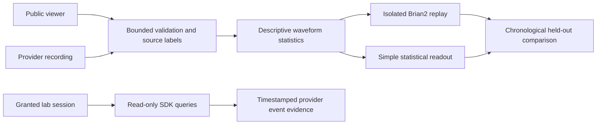

# Biological-data integration record

The integration reads the current FinalSpark public viewer and can replay captured
waveforms through a new Brian2 circuit. It does not connect Nuria to a booked
organoid or establish biological learning. Existing neural histories and the
observatory design are unchanged.



## Public observation, 30 October 2026 UTC

[Observation receipt](public-observation-01.json): one bounded subscription
received three four-electrode, 1,600-sample-per-channel frames in 7.06 seconds.
All nine HTTP requests returned 200, and the connection explicitly disconnected.
The three frame hashes differ. Total received traffic was 515,669 bytes, including
controller metadata and packets not retained after reaching the frame cap.
No credentials or lab control methods were used.

The endpoint is `https://livenp.finalspark.com`. Raw vendor samples remain outside
this repository pending redistribution terms. The receipt retains their hashes,
receiver timestamps and descriptive statistics. These are receiver observations,
not an independent attestation of culture identity, biological origin, live
acquisition time, physical units or continuity. No public API rate has been
silently substituted for a verified acquisition rate.

[Matched replay](public-bridge-01.json): the baseline and waveform-driven arms
started from the same neural state hash. All **3/3** measured spike windows
differed. The fixed mapping affects only sensory neurons and is bounded by 0.18.
Each arm uses three 100 ms simulated windows. This is a working causal input
connection, not evidence of intelligence or useful biological computation.

## Synthetic software comparison

The [complete generated course](synthetic-course-01.json) is an explicit synthetic
fixture, with 12 non-overlapping one-second windows and a supplied scalar label.
It is not a cultured-neuron recording, a useful skill benchmark or a discovery.
The [protocol](synthetic-protocol-01.json) was saved before model execution, and
the [full numeric result](synthetic-comparison-01.json) retains features, labels,
normalization, fitted weights and predictions.

| Method                                     | Test mean squared error | Test windows |
| ------------------------------------------ | ----------------------: | -----------: |
| Ridge on waveform statistics               |                0.204492 |            3 |
| Same statistics plus fixed Brian2 response |                0.414114 |            3 |

Adding the neural transform worsened this fixture's error. No parameter search
or seed selection was performed to replace that outcome. The baseline has the
same waveform information; only the candidate pays for the Brian2 transform.
The readouts share train-only normalization and the same validation-selected
ridge strengths. Circuit state resets before each window, with no label feedback.

Replay the retained readout fitting and scoring without a network connection:

```sh
python -m scripts.finalspark verify research/biology/synthetic-comparison-01.json
```

Regenerate the full fixture in a new directory, including actual Brian2 features:

```sh
python -m scripts.finalspark compare research/biology/synthetic-course-01.json run/biology-fixture-replay-001
```

Independent score reconstruction checks the stored feature/readout evidence.
Full regeneration additionally checks the circuit path, subject to numerical
library versions. Neither route verifies a public signal's biological provenance.

## What still requires provider access

The v2 database query boundary is tested with a substitute controller. No granted
SDK session, culture recording, live stimulation or tissue adaptation was tested.
The optional HDF5 importer has no FinalSpark-file validation yet. JSON and numeric
NPY import, the current public protocol and actual Brian2 replay are exercised.

Obtain a small annotated dataset with explicit use/publication rights and an
assigned supported SDK session. Freeze a biologically meaningful task and
artifact controls before examining held-out outcomes. Compare against strong
simple readouts and use new sessions or cultures for transfer. The present
software prepares that test; it does not supply a missing biological result.

See [commands and data contract](../../docs/biology.md), the
[official SDK guide](https://finalspark-np.github.io/np-docs/np_core/doc_v2.html)
and [provider laboratory guidance](https://finalspark-np.github.io/np-docs/np_core/faq.html).
