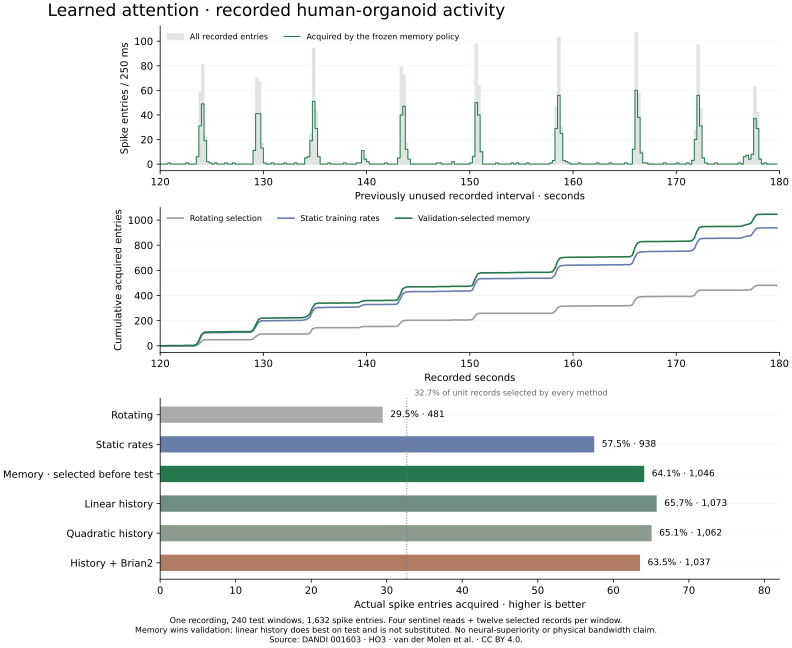
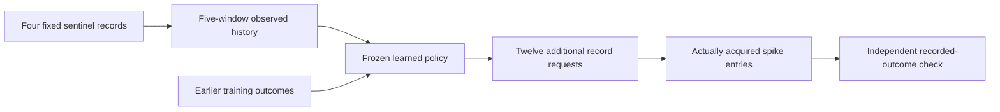

# Learned attention over recorded organoid signals

A frozen acquisition policy captured **1,046 of 1,632 spike entries (64.1%)**
while selecting **16 of 49 unit records per window (32.7%)** in the later minute
of the HO3 recording. Selecting the same training-most-active units captured
938 entries (57.5%). The learned policy therefore acquired 108 more recorded
entries, an 11.5% increase under the identical record budget.

This is a useful, bounded attention result. **Nearest-neighbour memory was the
validation-selected policy; the spiking alternative did not beat it.** This does
not establish a neural intelligence advantage, consciousness or live biological
control. The original forecasting failure remains [published](../dandi-01).



## What the policy actually does

Each completed 250 ms window contains counts for 49 curated sorted units. The
policy first reads four fixed sentinel records: IDs 0, 12, 24 and 36. It sees
their current counts and four preceding sentinel windows. It then selects twelve
other unit records for detailed acquisition from that **same completed window**.
The evaluator, which owns all counts, returns and scores only that selection.
Unselected records never enter the policy's inputs or subsequent state.

This is two-stage read selection, not forecasting a future window, a streaming
electrode-switching trial or tissue stimulation. Sorted units are analytical
clusters, not identified individual neurons. The assay charges unit records,
not dollars, hardware energy, bytes or end-to-end CPU time. Full source data is
available to the offline judge; no measured physical bandwidth saving is claimed.



## Source and development boundary

The source is the same pinned, openly licensed recording used by the
[DANDI import](../dandi-01): van der Molen et al.,
[DANDI 001603 version 0.260923.0623](https://dandiarchive.org/dandiset/001603/0.260923.0623),
asset `356d4cb3-c817-419b-bf7d-3345931f41be`, human organoid HO3.
Original NWB SHA256:
`d5e5f72db06de01db28c7fbbe5ef2166b8e739a8810e1b548463edf02555c5b1`.
The [CC BY 4.0 attribution and derivative description](../dandi-01/attribution.json)
also apply here. This derivative extends the original half-open 250 ms event-time
bins to all 180 seconds. All 49 units and all 4,721 spike-time entries are retained,
including the coincident duplicate entry. No new laboratory measurement occurred.
Exact event-time bins differ from the publisher millisecond binary grid in
15 of 35,280 unit-bins over the complete interval; the binary grid contains one
fewer entry. The original event-time rule and duplicate remain unchanged.

The recording's first 120 seconds were already exposed in an earlier, different
forecasting study. The present task uses 0–80 seconds for decoder training, 80–120
for model selection, and the previously unused 120–180 for one test. These are
320, 160 and 240 windows, respectively. Test results were opened only after
`selection.json` had been written. The protocol is a retained local commitment,
not an independently timestamped preregistration. One later minute from the same
culture is not cross-culture transfer or an untouched external benchmark.

## Fixed alternatives and outcomes

The [protocol](protocol.json) fixes the input, record budget, chronological splits,
models, parameter choices and utility before execution. Every method has access
to the same sentinel history and original training data. Ridge normalization is
train-only; the fixed strengths are 0.01, 1 and 100. Nearest-neighbour choices are
3, 9 and 27. Parameters and the deployed method are selected on validation
acquired entries, not test scores. Ties have a deterministic declared order.

| Method                                    | Validation acquired / 924 | Later-minute acquired / 1,632 | Test fraction |
| ----------------------------------------- | ------------------------: | ----------------------------: | ------------: |
| Rotating selection                        |                       293 |                           481 |         29.5% |
| Static training rates                     |                       530 |                           938 |         57.5% |
| **Sentinel nearest neighbours, selected** |                   **613** |                     **1,046** |     **64.1%** |
| Linear history readout                    |                       610 |                         1,073 |         65.7% |
| Quadratic history readout                 |                       596 |                         1,062 |         65.1% |
| History plus measured Brian2 response     |                       584 |                         1,037 |         63.5% |

The selected neighbour count is 27. All three ridge conditions select strength 100. Linear history does best on test, but **does not replace the frozen choice**.
Every method reads 3,840 of the 11,760 available unit records in the test interval.
The learned selected policy misses 586 entries; it is not a lossless compressor.
The full [selection](selection.json), [fits](selection.json), [actions and outcomes](result.json)
remain available, including every unsuccessful alternative.

The quadratic readout uses conventional nonlinear vector autoregression,
following the established [next-generation reservoir approach](https://doi.org/10.1038/s41467-021-25801-2).
The statistical memory method uses ordinary nearest neighbours. These are reused
technical approaches, not newly invented learning algorithms.

## The neural condition

A new isolated Brian2 reservoir receives only the four sentinels. Its 64 neurons
have 50, 250 and 1,000 ms membrane time constants, recurrent excitation and
inhibition, and fixed seed 7321. Each recorded window advances 250 simulated ms.
Its per-window spikes and end-window membrane values augment the exact same
twenty history features used by the linear decoder. Training outcomes fit the
readout, but do not enter the reservoir or modify its synapses.

All 720 [measured neural feature rows](neural.json) are retained. The entire
experiment took 26.06 seconds locally. This wall time includes the neural
condition and model selection; it is not a speed comparison. Neither the
original 1,024-neuron worker nor its history is opened. The successful default
uses ordinary memory because the spiking alternative did not justify promotion.

## Use the learned policy

The [streaming picker](../../../cognition/active_observation.py) receives exactly
four counts per call, with no argument for unobserved records. Start at the first
recorded window and include the original warm-up history. It is a finite,
source-bound 720-window profile; arbitrary future recordings need their own
source contract and qualification.

```python
import json
from pathlib import Path

from cognition.active_observation import RecordPicker

package = Path("research/biology/acquisition-01")
selection = json.loads((package / "selection.json").read_text())
recording = json.loads((package / "binned.json").read_text())
picker = RecordPicker(selection, recording["counts"][:480])

for window in recording["counts"]:
    decision = picker.observe([window[i] for i in (0, 12, 24, 36)])
    # A separate source host retrieves decision["extra_unit_ids"].
```

A test executes this interface over the complete record and reproduces every
committed test acquisition. Each decision binds the frozen policy hash and
window index. The picker makes no network request and grants no wallet, provider
or laboratory access. It is not enrolled in the public application.

## Reproduce and inspect

```sh
python -m scripts.active_observation verify research/biology/acquisition-01

# The optional PyNWB dependencies are required only for original import/replay.
python -m scripts.active_observation run \
  run/dandi/human-HO3.nwb \
  research/biology/dandi-01/binned.json \
  run/acquisition-replay-001
```

The output directory must be new. `selection.json` commits before opening the
later recorded interval. The offline verifier reconstructs training fits,
parameter trials, validation selection, every test action and acquired entry.
It does not independently attest tissue provenance or regenerate Brian2 features.
An optional original-NWB test checks all 180 seconds through PyNWB. Re-running
the full command regenerates the separate neural features and measured choices.
No inference API, purchase, token launch or production worker is involved.
