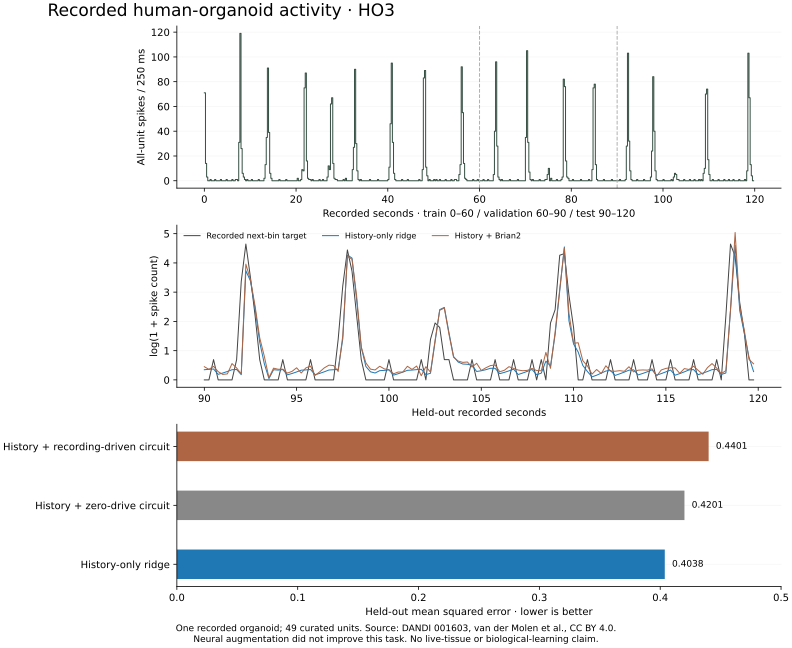

# Recorded human-organoid spike replay

This experiment connects one openly licensed human-organoid recording to an
isolated Nuria circuit. All 49 curated sorted units are retained. It establishes
a working recorded-data path and a reproducible negative neural comparison.
It is separate from live Nuria inputs, original neural history and financial
authority. No live tissue is connected.



## Source and attribution

- **Archive:** [DANDI 001603, version 0.260923.0623](https://dandiarchive.org/dandiset/001603/0.260923.0623).
- **Study:** van der Molen et al., [Preconfigured neuronal firing sequences in human brain organoids](https://doi.org/10.1038/s41593-025-02111-0), Nature Neuroscience.
- **Asset:** `356d4cb3-c817-419b-bf7d-3345931f41be`, `sub-HO3/sub-HO3_ses-20250916T190937.nwb`.
- **Original size:** 9,066,104 bytes.
- **Original SHA256:** `d5e5f72db06de01db28c7fbbe5ef2166b8e739a8810e1b548463edf02555c5b1`.
- **License:** [CC BY 4.0](https://creativecommons.org/licenses/by/4.0/). Full dataset citation and derivative description are retained in [attribution.json](attribution.json).

Both the archive metadata and the NWB Subject identify HO3 as human. The archive
contains other species; this experiment does not pool them. The NWB identifier is
`HO3_6M_sorted.mat`, with curated spike times and a publisher-provided one-millisecond
count grid. Sorted units are analytical clusters, not independently identified
individual neurons. Source attribution is supported by the archive and study;
the software does not independently attest the original tissue.

The [binned derivative](binned.json) includes the fixed first 120 seconds as 480
half-open 250 ms bins, retaining **3,089 spike-time entries** across all 49 units.
The source contains 4,721 entries; 1,632 outside this interval are explicitly
excluded. No unit, low-activity period or failed prediction was selected away.
These counts retain their real recording-time axis. The simulated circuit runs
250 ms for each recorded 250 ms bin, in a separate offline history.

## Data-quality discrepancy retained

Direct event-time binning differs from the publisher's count grid in **9 of 23,520
unit-bins**. The total differs by one entry. The
[exact differences](binning-differences.json) include a repeated timestamp at
32.80005 seconds in unit 15 and events shifted across four 250 ms boundaries.

A [numerical reconstruction](quantization-diagnosis.json) reproduces every cell
of the publisher's grid over this interval by rounding to the nearest millisecond,
shifting one sample and using binary occupancy, which collapses coincident entries.
This reconstructs the data; it does not claim knowledge of undocumented original
conversion code. The experiment keeps the original exact-time rule and duplicate
entries. It does not change preprocessing after seeing the comparison scores.

## Fixed comparison

The [protocol](protocol.json) was retained before circuit execution or scoring.
Its rule digest is `83725b82fc05a1c5e5379e18f072f44746be6b92ab2fb064dccfedd128127228`.

Each prediction observes four recent all-unit count vectors, their cumulative
mean and a causal exponential average. The target is the logarithm of one plus
the next bin's total spike count. Both fitted conditions receive those identical
history features. The candidate adds actual Brian2 features from the recording-
driven circuit; a matched zero-drive circuit supplies a separate control.

The neural mapping is fixed: a bounded transform of each unit's count drives a
fixed partition of the 128 sensory neurons. It is not a fitted biophysical model
of HO3, a cell-identity mapping or preservation of sub-bin spike timing. No labels,
targets, rewards or fitted readouts feed back into either circuit.

Targets are partitioned chronologically: 236 training predictions, 120 validation
and 120 test. Normalization uses training data only. Three declared ridge
strengths are selected on validation. The simple comparator is selected by
validation from a training mean, last-bin persistence, exponential average and
history-only ridge model. Test errors do not select the comparator.

| Method                                              | Held-out MSE |
| --------------------------------------------------- | -----------: |
| Training mean                                       |     1.465134 |
| Last-bin persistence                                |     0.655953 |
| Exponential average                                 |     1.286638 |
| **History-only ridge — selected simple comparator** | **0.403783** |
| Same history + zero-drive Brian2 features           |     0.420062 |
| Same history + recording-driven Brian2 features     |     0.440078 |

The conventional history model wins. Adding the recording-driven circuit raises
error by about 9%. No seed replacement or follow-up tuning substitutes a better
result. Both circuits start from the same measured state; their spike hashes
differ in all 480 windows. Changed activity does not establish better decisions.

The [complete result](result.json) retains every input feature, measured neural
feature, state/spike hash, fitted readout, validation loss, test target and test
prediction. The score verifier reconstructs the past-only design, chronological
split, comparator choice, fitted readouts and scores. It also checks the neural
observation links. It does not independently regenerate neural features; a fresh
full run is the stronger reproduction path.

## Reproduce

Install the normal core requirements and the isolated optional reader pins:

```sh
python -m pip install -r requirements.txt -r research/biology/requirements.txt
python -m scripts.dandi_replay download run/dandi-source-001
python -m scripts.dandi_replay import run/dandi-source-001/human-HO3.nwb run/dandi-binned-001.json
python -m scripts.dandi_replay run run/dandi-binned-001.json run/dandi-replay-001
python -m scripts.dandi_replay verify run/dandi-binned-001.json run/dandi-replay-001/result.json
```

All output paths must be new. Acquisition verifies the exact archive version's
asset membership, human attribution, access status, license, size and SHA256.
PyNWB reads the original file; no custom NWB decoder is used. Reads use finite
socket timeouts and byte limits. The replay has a 180-second wall admission check
between windows. The retained run took about 72 seconds locally; that observation
is not a performance guarantee for another host.

Offline refitting and score verification needs only the core NumPy environment:

```sh
python -m scripts.dandi_replay verify research/biology/dandi-01/binned.json research/biology/dandi-01/result.json
```

CI additionally acquires the pinned original and checks that PyNWB import exactly
reproduces the published counts. Plot regeneration uses optional matplotlib:

```sh
python -m scripts.plot_organoid_replay research/biology/dandi-01 run/dandi-comparison.svg
```

## Limits

This is one short, spontaneously active recorded organoid. It cannot respond to
new trades, demonstrate tissue adaptation or establish consciousness. The
forecast is a narrow electrophysiology task, not an agent-hiring or purchasing
outcome. The results neither establish a neural advantage nor test cross-culture
generalization. Future controlled experiments require new data and a new protocol;
this held-out interval must not become an undisclosed tuning set.
