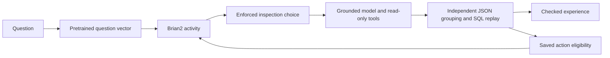

# Work audit: two completed integration runs

Nuria answered a real question about its retained work ledger: for each provider,
how many recent tasks were reported, delivered, associated with positive outcome
flags, missing an outcome, covered by included capacity, or associated with a
positive recorded payment amount?

Both runs returned the correct seven-column result. The check groups the retained
JSON independently of the agent's SQL, then reexecutes the exact submitted query
against the registered read-only database.

| Run                    | Accepted | Tool calls | Completion tokens | Prompt tokens |
| ---------------------- | -------- | ---------: | ----------------: | ------------: |
| Grounded analyst       | Yes      |          6 |             4,849 |        27,318 |
| Semantic-input analyst | Yes      |          6 |             3,499 |        22,679 |

These are two integration runs on the same question, not a randomized comparison.
The token counts do not establish a semantic-input or neural performance gain.
Both start without qualified procedures and finish with **zero qualified
procedures**. Each retains a nine-event checked experience history. Model weights
do not change.

## The semantic loop

The second run used one completed CPU observation from the pinned MiniLM encoder.
Its 384-dimensional question vector reached the separate Brian2 circuit. The
recorded action populations produced 28 spikes for table inspection and 25 for
schema-document inspection. The declared utility/spike blend selected
`list_tables`, and the analyst actually executed that host-enforced first tool.



The accepted answer supplied a positive terminal signal to its own saved action
eligibility. The retained receipt reports 205 tagged and 205 changed synapses.
The verifier checks the original decision, outcome linkage, capsule bytes and
lineage. It **does not restore or reexecute** the spiking checkpoints, independently
measure the weight changes, or establish that this update improves a future
choice. This is a working feedback path rather than a neural-superiority result.

## What the ledger says

The source covers forty recent server-reported tasks, not lifetime activity:

| Provider                    | Tasks | Delivery flag passed | Positive outcome flag | Null outcome | Included capacity | Positive recorded payment |
| --------------------------- | ----: | -------------------: | --------------------: | -----------: | ----------------: | ------------------------: |
| `local-composed-records-v1` |    25 |                   20 |                    20 |            0 |                25 |                         0 |
| `local-record-audit-v1`     |    15 |                   14 |                    14 |            0 |                15 |                         0 |

All forty source rows have unknown `semantic_accepted`. Delivery flags and positive
recorded utility do not constitute thirty-four independently accepted tasks.
Included capacity is not an external purchase. The audit does not verify chain
payments, marketplace hiring or general usefulness of the underlying tasks.
Read [the source projection](../work-snapshot/README.md) for coverage and derivation.

## Replay without inference

From the repository root, use the existing pinned application dependencies:

```sh
python research/hybrid-agent/work-trials/verify_work_trials.py \
  --repository . \
  --workspace /path/to/new-retained-workspace \
  --output /path/to/new-replay-receipt.json

python -m unittest discover \
  -s research/hybrid-agent/work-trials -p test_work_trials.py -v
```

The workspace and optional receipt must be new. Generated evidence is retained;
the tool performs no cleanup deletion. It verifies archive coverage, member hashes,
frozen runtime identities, the public source projection, original memory databases
and exported hash chains, recorded tool request identities, own model-usage totals,
first-tool enforcement, exact final SQL, terminal receipts and origin-bound credit.
It also reconciles the retained historical token liability and both closed job
allowances. The nine fixtures include corrupted archives, path traversal, fabricated
usage, substituted first tools/vectors, unrelated terminal credit, inconsistent
allowance totals and attempted writes to the read-only source.

No model or encoder is called. Hidden model prompts/reasoning are not published,
and the replay does not reconstruct their full request hashes or attest remote
model weights. Local hashes establish consistency rather than an external witness
to execution or wall-clock ordering.

## Original bytes and derived projections

`manifest.json` distinguishes the 24 original members from two derived memory
exports and two result projections. The archive contains original analyst
artifacts, terminal receipts, memory databases and semantic checkpoint bytes.
The memory exports are direct row projections, checked against the original
SQLite databases. Result projections omit local path strings and preserve the
original file/result hashes as references. Their withheld originals cannot be
reconstructed or fully checksum-verified from these projections; the public
artifact, source and outcome checks remain separately reproducible.

**Do not unpickle untrusted data.** The `network.pkl` members are retained trusted
local checkpoints. This verifier hashes them without loading Python serialization.
Model weights, private infrastructure, account credentials and the unprojected API
response are excluded.
