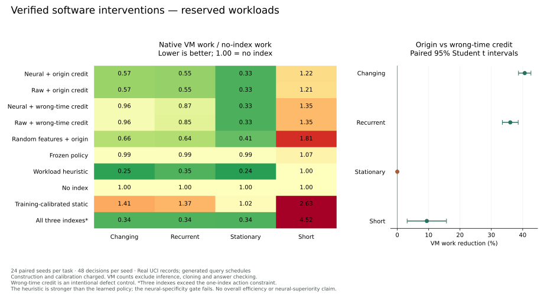

# Verified software interventions

This laboratory connects a persistent spiking context to interventions in actual SQLite execution. A bounded controller selects one of three registered indexes or no index, receives independently checked results and measured execution work, and retains source-specific intervention evidence. The live organism and its financial authority are separate.

The dataset contains real bike-rental observations; query workloads are generated. The comparison uses native SQLite statement counters, not a synthetic reward function. Policy replay sees selected measurements only. Fresh native batch executions independently check that measured query costs compose exactly. VM work excludes parsing, cloning, correctness checking and policy/neural inference; it is not an energy, dollar or wall-clock speed claim.

## Comparison

The frozen protocol specifies four workload families, three development seeds and twenty-four reserved seeds. Complete costs include index construction, initial exploration and training-only profiling. Raw-context, random-feature, frequency-heuristic, static-training, frozen and intentionally misattributed-credit branches remain visible. An all-three-index native-planner reference is explicitly outside the one-index capacity constraint.

The shared-feature comparison evaluates origin-bound contextual learning, not the benefit of outcome-dependent synaptic plasticity. The separate isolated runner performs actual SQL execution and delayed tagged synaptic credit, checkpoints both neural and learning state, and refuses changed input history. Recovery tests compare uninterrupted and resumed spikes and decisions exactly. These are different evidence scopes.

## Reserved results

Version 2 contains 960 trial branches: four task families × twenty-four reserved
seeds × ten methods. Each branch makes 48 decisions. All 46,080 trace rows and 480
fresh native batch audits are retained. Exact SQL answer and composition checks
pass. The registered benefit, credit and static noninferiority gates pass;
**the neural-specificity gate fails**.

Mean construction-inclusive VM operations per 48-decision stream, in millions:

| Workload   | Neural + origin | Raw + origin | Wrong-time neural credit | Workload rule |  No index | Three-index reference |
| ---------- | --------------: | -----------: | -----------------------: | ------------: | --------: | --------------------: |
| Changing   |          50.844 |       50.924 |                   85.804 |    **22.644** |    89.727 |                30.953 |
| Recurrent  |          48.936 |       48.829 |                   76.891 |    **30.746** |    88.796 |                30.524 |
| Stationary |          29.212 |       29.092 |                   29.212 |    **21.215** |    87.720 |                29.594 |
| Short      |           6.844 |        6.801 |                    7.568 |     **5.620** | **5.620** |                25.407 |

The three-index reference exceeds the one-index action constraint. The
[complete report](validation/result.json) also retains frozen, random-feature and
training-calibrated static branches; the figure shows every registered method.



Origin-bound learning uses **40.6% less measured VM work on changing workloads**
than the deliberately wrong-time neural control (paired pointwise 95% interval
38.7–42.6%), and **36.0% less on recurrent workloads** (33.5–38.6%). Raw-context
learning shows the same mechanism benefit, 40.5% and 35.1%. These contrasts support
preserving the decision's original context when feedback arrives late; they do not
establish an advantage over well-implemented asynchronous optimizers.

The neural learner reduces work versus no index by 43.3% and 44.9% on those two
families. However, the workload rule wins every reserved stream against it, and
neural-vs-raw paired intervals include zero on all four families. On short tasks,
exploration raises work **21.8% above doing nothing** (11.9–31.7%). Retaining an
explicit no-intervention choice is necessary but does not make this learner good
at choosing it. No neural superiority or production-policy promotion follows.

The static gate charges all initial profiling; passing it does not mean beating a
stronger optimizer. Intervals describe variation across generated workload seeds
on this one dataset and native build. They do not describe arbitrary databases,
hardware or real user workloads. The scientific outcome is a tested mechanism and
specific failure boundaries, not a new database algorithm or AI breakthrough.

## What executes

The tool accepts bounded integer query parameters, not arbitrary SQL. Four actions
are registered: no index, or one index on `hr,weekday`, `mnth,workingday` or
`weathersit,season`. SQLite chooses its query plan with automatic indexes explicitly
disabled in every branch. A fifth reference creates all three indexes, exceeding
the learner's one-index constraint; construction and storage remain charged.

Each workload starts from a fresh in-memory database. The learner retains policy
knowledge and intervention evidence, not a physical index across workloads. It
sees the current workload histogram, previous histogram and query count. Neural
branches additionally receive sixteen pooled features from actual Brian2 spikes.
The input mapping is an explicit engineering choice. No TVB simulation participates
in this comparison.

The evaluator measures all 208 possible query predicates against each registered
configuration using the native C API's statement counters. Policy replay accesses
only its chosen result. A fresh native batch for a registered block in every
task/seed checks exact answer and cost composition across all five configurations.
This combines a measured kernel with batch audits; it is not 46,080 separate
full-database executions. Answer checks compare executions of the same SQLite
build, rather than an independently implemented SQL engine.

The contextual learner is conventional discounted ridge UCB. Its utility is
`clip(1 - selected_VM_work / 2,000,000, -1, 1)`; the fixed scale discloses no
unchosen cost. The first four decisions cover the four actions. This exploration
can be wasteful on short workloads. Static training profiles every action during
the first twelve blocks and pays that entire calibration cost. The primary score
includes construction, exploration and calibration; post-calibration scores are
secondary. Policy and neural CPU measurements are retained separately.

## Delayed credit and recovery

An intent binds source, origin step, selected action, visible context and numerical
selection scores. A checked receipt refers to that intent. Exact duplicate
feedback has no second effect; changed duplicates, unknown origins and reordered
receipt sequences are refused. An intentionally defective control learns against
the context at delivery time. It tests the temporal-credit mechanism and is not a
competitive database optimizer.

The standalone runner also retains the originating action-region eligibility
trace. When a result arrives, bounded feedback changes the tagged synapses rather
than substituting current eligibility. Controller state, complete trusted neural
checkpoint, pending feedback, input cursor and journal commit together. The
published neural state hash is a variable projection; complete checkpoints also
carry random and delayed simulator state. Resume binds code, dataset, controller
configuration, Brian2/NumPy versions and native SQLite build settings.

The [retained execution](runner/execution.json) completes twelve workloads and all
twelve receipts. Selected work is 17,434,529 VM operations; separate answer checking
adds 22,561,552. Nine of the ten feedback deliveries occurring inside observation
records change tagged synapses; the final two receipts flush at stream completion.
This establishes execution and credit wiring, not useful synaptic learning or
overall efficiency. The runner uses alpha 0.75 for this wiring example; the
comparative protocol independently selects and fixes alpha 0.5 on development
data. No financial transaction occurs.

An additional [dedicated-server execution](runner/server-execution.json) completes
the same twelve workloads and checked receipts under SQLite 3.45.1, Brian2 2.10.1
and NumPy 2.5.3. It records 17,434,145 selected VM operations plus 22,561,168 for
answer checking. The [server receipt](runner/server-verification.json) records
unchanged live-worker processes and financial policy. This establishes portable
execution with explicit build identity; it does not claim cross-build numerical
identity or independent experimental witnessing.

Recovery tests compare eight-step uninterrupted and resumed spikes, intents and
final neural/policy states. Injected precommit failure restores the previous joint
checkpoint. An unfinished execution may have consumed physical compute before
that checkpoint: recovery preserves an accounting-uncertainty flag rather than
claiming exactly-once physical execution. Post-execution VM checks supplement the
bounded dataset and query allowlist; they are not an interrupting VM quota.

## Protocol history

[Version 1](v1/protocol.json) broke simultaneous-delivery ties by intent hash.
Because hashes differ across methods and learning discounts older evidence, this
confounded its temporal-context contrast. Its complete measurements remain in
[the v1 archive](v1/validation/result.json); they are not used for the isolated
credit-attribution claim.

[Version 2](protocol.json) fixes delivery order to `(due_step, origin_step)` and
reserves fresh seeds 5001–5024. The protocol and six evaluated source hashes were
published at [6c1d591](https://github.com/trynuria/nuria/commit/6c1d59156b2eaca9a81cf578fb040d4032606cfa)
before scoring those seeds. Alpha, discount, tasks, metrics, comparators and gates
were unchanged; no reserved-outcome retuning occurred. The earlier interrupted
v1 attempt produced partial traces but no final report; its unchanged full rerun
is retained. Development also exposed a weak sensory drive, corrected before the
first reserved run. The complete four-alpha development search is retained in
[development-search.json](development-search.json).

## Reproduce

Install the root `requirements.txt` in an isolated environment. Retained arithmetic
and every selected-feedback policy decision can be reconstructed without running
the original simulator or native measurement build:

```sh
python -m scripts.verify_intervention_memory research/intervention-memory/validation
```

The verifier imports neither the evaluator, controller nor SQLite lab. It checks
source and artifact commitments, registered coverage, generated schedules, spike
feature pooling, selected-only feedback, ridge scores, charged calibration, paired
intervals and batch agreement. This is a separate implementation checking retained
evidence, not an external witness or independent native/simulator rerun. Its final
post-stream matrix state is not reconstructed; the standalone recovery tests cover
that distinct execution scope.

Extract the retained public dataset and run a new isolated intervention history:

```sh
python -c "import zipfile,pathlib; pathlib.Path('hour.csv').write_bytes(zipfile.ZipFile('research/intervention-memory/data/bike-sharing-original.zip').read('hour.csv'))"
python -m scripts.run_sqlite_interventions hour.csv research/intervention-memory/runner/workloads.jsonl .test-state/sqlite-agent-new .test-state/sqlite-agent-new.json
python -m unittest discover -s tests -p 'test_intervention*.py' -v
```

Use new output/state names for a fresh experiment; existing evidence is preserved.
Native VM counts are build-specific. Full comparative reproduction requires the
protocol's SQLite version, source ID and compile options; other builds are refused
for that registered comparison. The standalone tool can establish its own isolated
history on another build without pretending the counts are comparable:

```sh
python -m scripts.evaluate_intervention_memory hour.csv .test-state/sqlite-comparison-new --phase validation
```

Historical v1 evidence uses its historical source revision (available in a full
checkout):

```sh
python -m scripts.verify_intervention_memory research/intervention-memory/v1/validation --protocol research/intervention-memory/v1/protocol.json --source-ref a7e9b323149f5cbaa18dee338de73cc5b29ca338
```

## Data and attribution

Fanaee-T, H. (2013). _Bike Sharing_ [Dataset]. UCI Machine Learning Repository. [DOI:10.24432/C5W894](https://doi.org/10.24432/C5W894). Licensed [CC BY4.0](https://creativecommons.org/licenses/by/4.0/). The retained original archive contains `hour.csv`, with 17,379 records. The source summary reports 17,389; this laboratory uses the actual parsed count. Archive and CSV hashes are fixed in the protocol. Only seven integer columns are loaded; original archive bytes are unchanged. Workload generation and index interventions are experimental transformations, not original dataset labels.

## Prior work

Learning database configurations is established research. [UDO](https://www.vldb.org/pvldb/vol14/p3402-wang.pdf) measures real query executions and handles expensive configuration changes and delayed feedback. [SWIRL](https://openproceedings.org/2022/conf/edbt/paper-37.pdf) studies workload-aware index selection. This implementation claims neither a new index-advisor algorithm nor first-ever autonomous optimization. Its focus is an inspectable chain from decision, intervention and measured correctness to delayed learning and exact recovery.

[SQLite statement counters](https://sqlite.org/c3ref/c_stmtstatus_counter.html) define the native VM-work metric. The controller chooses available physical indexes; SQLite retains its own query planner. The controlled comparison does not establish consciousness, general intelligence, biological fidelity, a TVB advantage or market profitability.
