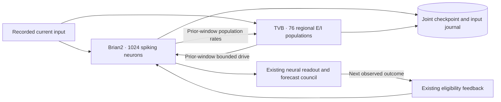
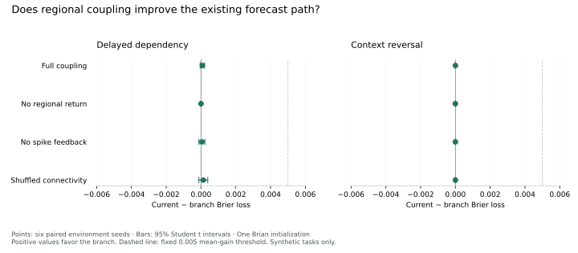

# TVB–Brian2 comparison

This experiment couples Nuria's existing 1,024-neuron Brian2 circuit to 76
Wilson–Cowan regional populations running in The Virtual Brain. It is an
additional, separately checkpointed circuit. It does not replace the running
organism, change financial authority or supply living neurons.

The [fixed protocol](protocol.json) was committed before scoring the comparison.
Its [SHA256](protocol.sha256) fixes the tasks, seeds, controls and promotion gate.
The implementation uses the actual TVB simulator, tract-delay history and
deterministic Heun integrator; it does not reimplement a similar set of equations
and call that TVB.

## Exchange between scales

Each window advances both models by 20 ms. Brian receives the regional activity
available at the start of that window. TVB receives the preceding window's
measured Brian population rates. Current input also stimulates a declared TVB
input port. Both directions therefore have a one-window exchange delay. No
future labels enter either model.

Regional activity supplies a bounded additional drive, at most ±0.12, to the
existing Brian populations. It does not add new features to the readout. The
unchanged 72-dimensional readout and seven-specialist forecast council receive
the resulting measured spikes. Outcome feedback still updates Brian's eligible
synapses. The TVB structural weights are fixed; this implementation does not
claim learned regional connectivity.

The named anatomical ports are explicit engineering choices. Mapping the
synthetic `memory` population to hippocampal-labelled nodes does not establish
human memory function or anatomical equivalence.



## Dataset provenance

The input is `connectivity_76.zip` from `tvb-data==3.0.0`, SHA256
`8b856d5fa80a8593e01dc18b95efff829ca98d2daf43cea38fd3309fed726b2e`.
The loader refuses changed dataset bytes.

TVB documents this demonstration dataset as a hybrid of CoCoMac and DSI data.
CoCoMac concerns macaque connectivity. This is **not a purely human connectome,
a personalized brain reconstruction or a dataset from Nuria's owner**. The
comparison establishes an integration method, not human anatomical validation.

- [TVB complete dataset description](https://docs.thevirtualbrain.org/manuals/UserGuide/Complete_Dataset_Description.html)
- [CoCoMac description](https://cocomac.g-node.org/main/faq.php)
- [TVB data package](https://pypi.org/project/tvb-data/3.0.0/)
- [TVB scientific library](https://pypi.org/project/tvb-library/2.10.0/)
- [Leon et al., 2013: simulator of primate brain-network dynamics](https://doi.org/10.3389/fninf.2013.00010)

## Recorded result

**The integration works; the fixed predictive promotion gate failed.** The live
cognitive worker remains the current Brian2 model. More regional structure did
not establish a useful forecasting improvement in these tasks.

The run contains 60 task/seed/branch groups, 9,600 windows and 5,760 scored
forecasts. Six environment seeds share one fixed Brian initialization. Each
branch uses the same 160 inputs, with the first 64 reserved for warm-up. Brier
loss is squared probability error; lower is better.

| Task               | Current Brier | Coupled Brier | Paired gain | 95% interval for gain       |
| ------------------ | ------------: | ------------: | ----------: | --------------------------- |
| Delayed dependency |   0.211861651 |   0.211783101 | 0.000078549 | −0.000048768 to 0.000205866 |
| Context reversal   |   0.250921123 |   0.250920737 | 0.000000386 | −0.000000170 to 0.000000942 |

Both intervals include zero. Neither mean gain reaches the precommitted 0.005
threshold. Shuffled connectivity also yields small changes; the results do not
establish an advantage from this anatomical organization. All controls and
individual trials, including null results, are retained in [result.json](results/result.json).

The zero-return control reproduces the current circuit's neural hashes in all
1,920 matched windows. Full coupling changes the neural projection in 1,908 of
1,920 windows and changes the actual action-region spike-score vector in 1,898.
Those are measured intervention effects, not completed actions or useful
behavioral outcomes. No autonomous action policy was replaced by this study.



Mean measured processing time was 70.96 ms per current window and 77.73 ms per
coupled window, including readout, learning and evidence hashing. Process peak
RSS was 391.52 MiB and the complete run took 738.12 s on the recorded Darwin arm64
environment. These are bounded local measurements, with brief concurrent test
activity, not real-time or production capacity guarantees.

- [All prediction-time traces](results/traces.jsonl.gz), with compressed and uncompressed hashes in the result.
- [Independent score reconstruction](../../scripts/verify_multiscale_results.py) checks prior-prediction timing, primary Brier scores, paired intervals, complete coverage and the promotion decision.
- [Verification output](results/verification.json).
- Thirteen coupling/recovery tests pass on Darwin and GitHub's Linux runner. Five additional artifact tests reject changed traces, inflated scores, duplicate summaries and a reversed promotion decision.

The verifier reconstructs primary council Brier scores from prior predictions
and later observed labels. It checks reported secondary metrics against recorded
feedback; it is not an independent rerun of all neural dynamics or an external
witness to the experiment.

## Reproduce

Use a separate Python 3.14 environment; the active worker requirements are not
changed by this optional research package.

```sh
python3.14 -m venv .multiscale-venv
.multiscale-venv/bin/python -m pip install -r research/multiscale/requirements.txt
.multiscale-venv/bin/python -m unittest discover -s tests -p test_multiscale.py -v
OPENBLAS_NUM_THREADS=1 .multiscale-venv/bin/python -m scripts.evaluate_multiscale .test-state/multiscale-evaluation
```

The output directory must not exist. Results retain each seed, branch,
prediction, source-input hash and neural-state hash. Timing and RSS are local
observations, not production throughput guarantees.

To verify the retained public comparison without running TVB:

```sh
python -m scripts.verify_multiscale_results research/multiscale/results
python -m unittest discover -s tests -p test_multiscale_results.py -v
```

The verifier uses only the Python standard library. A full rerun additionally
requires the pinned scientific environment. Its source hashes must match; a new
experiment must use a new output directory and retain its own evidence.

For a separately supplied JSONL input file:

```sh
.multiscale-venv/bin/python -m scripts.replay_multiscale inputs.jsonl .test-state/multiscale-replay
```

This command performs no RPC or financial operation. It verifies local replay
integrity, not the input file's onchain provenance. Repeating the same file is
idempotent; changed old inputs and reordered history are refused.

## Recovery and boundaries

The experiment stores Brian's complete trusted checkpoint, TVB state and delay
ring, both coupling buffers, readout/council state and input cursor in one atomic
SQLite commit. A process lock prevents competing writers. A failed commit
requires reopening from the preceding complete checkpoint. Neither an old live
history nor a directory containing unrelated files can be silently adopted.

The Brian checkpoint contains a pickle, as the existing cognitive worker does.
Only trusted local checkpoints may be restored. Hashes detect changes; they do
not authenticate an attacker-supplied bundle. Checkpoints bind model settings,
dataset, clock alignment and numerical dependency versions.

The evaluation covers the perception/forecast path. Memory recall, workspace,
autonomous habitat actions, real token activity and paid outcomes are outside
its scope. Additional regions and altered spikes do not establish improved
behavior, consciousness or a benefit from human anatomy. Promotion requires the
published performance and recovery gates; a failed comparison remains visible.
