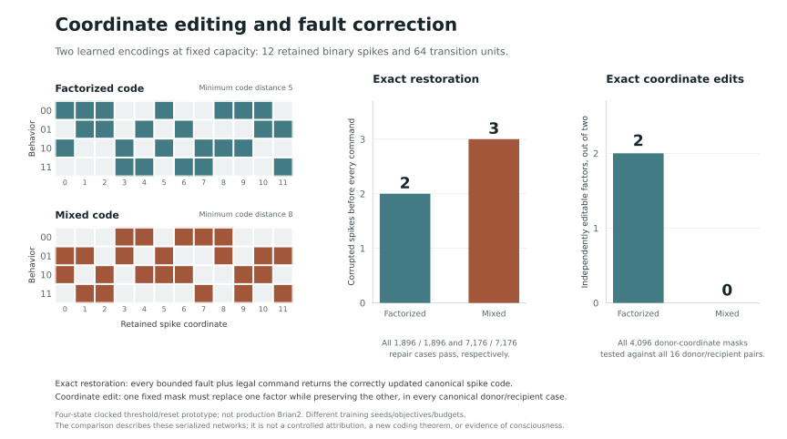

# Memory that survives an update

This experiment connects causal memory interventions, error-correcting codes and
finite-state verification. A learned recurrent threshold circuit remembers a
small task, updates that memory from commands, and repairs bounded corruption in
the same update. A separate learned neural policy can then act on the repaired
memory.

The result is a **checked finite capability**, not evidence of consciousness or
a new general learning algorithm. This module is separate from Nuria's running
Brian2 system and its isolated TVB comparisons. It has no wallet, market feed,
spending authority or production worker import.

## What changed

Earlier recurrent LIF trials lost the task on long compositions, while an ordinary
GRU retained it. The implementation here makes the complete recurrent state
explicit and finite: twelve queued spike bits. That makes it possible to check
every reachable state and every legal continuation, rather than infer memory
quality from an average score or a projection of hidden state.

Two learned instances show a concrete design tradeoff at that fixed capacity:

| Frozen memory | Minimum code distance | Repeated faults repaired before each command | Exact independently replaceable factors |
| ------------- | --------------------: | -------------------------------------------: | --------------------------------------: |
| Factorized    |                     5 |                            Any two bit flips |                                    Both |
| Mixed         |                     8 |                          Any three bit flips |                                 Neither |

The mixed representation was deliberately trained in two stages: a discrete
search first separated four codewords associated with observed query-response
classes; the recurrent network then learned to produce and update those codes
under noisy memory. The objective and code targets were supplied. This is not
spontaneous discovery of coding theory. The two instances have different seeds,
objectives and training budgets; the table is not a controlled ablation of those
ingredients.



## Task and information boundary

The resettable device contains two lamps. `flip` changes the first; `swap`
exchanges them; `noop` preserves them. A query returns **one lamp reading** after
a specified intervention suffix on a fork. Training targets come from executed
queries, including swap/read, not hidden state IDs. Initialization supplies two
readings obtained by those legal queries. Subsequent neural inputs contain only
the command and a binary nuisance channel; there is no fresh lamp observation.

The training set provides dense query outcomes. This is supervised acquisition
from interventions, not autonomous causal discovery. Evaluators know the device
specification and use hidden task variables only outside neural inference.

## Neural execution

Every command has two synchronous phases. A 64-neuron transition population fires
from input spikes and queued memory spikes; twelve memory neurons then fire from
the transition spikes. Membranes reset each phase. Only the twelve memory bits
persist. A threshold projection reads six predicted query outcomes.

Training uses surrogate-gradient backpropagation and exports integer weights at
scale 4096. Verification applies to the **quantized exported circuit**, not its
floating-point training trajectory. Runtime inference contains signed synaptic
sums and thresholds. It does not consult a state table, graph planner, symbolic
task decoder or external action utility.

This is a clocked binary threshold/reset idealization. It does not implement the
continuous membrane, delayed synapses, local STDP or biological interpretation of
the production Brian2 circuit.

## What is checked

1. **World conformance.** An independent integer runtime traverses the product of
   every reachable spike code and device state. Every legal command and either
   nuisance value must produce the correct observed consequences.
2. **Memory repair.** For each canonical code, every bounded XOR corruption and
   every command/nuisance pair must return the exact correctly updated canonical
   code. The mixed circuit passes all 7,176 radius-three cases. Induction permits
   a fresh adversarial corruption before every later command.
3. **State interventions.** Every coordinate mask is tested against all donor and
   recipient memories. Immediate output, all-future behavioral correctness and
   exact canonical replacement are separate criteria. Some masks pass every
   immediate output check but fail on the next command.
4. **Goal control.** A separately trained threshold policy consumes memory spikes
   and a fixed observable goal. Direct decisions from corrupted memory fail.
   A neural `noop` refresh before the same policy restores the guarantee: every
   allowed fault yields a unique valid action, STOP exactly at the goal, and a
   strictly decreasing task distance. The mixed circuit passes all 19,136 cases.
5. **Transport and repair.** A behavioral migration map between independently
   trained memories is checked over every future continuation. Blindly copying
   their spike bits fails. A permanent neuron clamp can break a learned skill;
   retraining with that clamp retained restores the checked contract.

The goal bound is at most three non-STOP actions for a **fixed goal**. Faults may
occur before each refresh-policy-action cycle, not between refresh and action.
This does not cover arbitrary timing, weight corruption, changing goals,
continuous neural dynamics or unmodelled tools. The refresh is a declared neural
operation and its cost is counted.

The ordinary graph planner already solves this small task directly and supplies
the policy's offline teaching labels. A conventional coded finite-state machine
can provide the same guarantee more simply. No neural efficiency or superiority
claim follows.

## The capacity constraint

Suppose all combinations of `k` binary factors have one complete canonical
`n`-bit code. Require a fixed donor-coordinate mask for each factor to construct
the **exact canonical hybrid code** for every donor/recipient pair. Every
nonconstant coordinate must then depend on only one factor. To uniquely correct
any `t` bit flips, each factor needs at least `2t+1` such coordinates:

`n >= k(2t + 1)`.

For two factors, twelve bits cannot simultaneously provide that exact editability
and three-bit correction. Four repetitions of a parity-equivalent three-bit code
can instead attain distance eight with twelve bits; the mixed learned circuit
implements that geometry. Fourteen bits suffice for both properties using seven
copies of each factor.

This is a restricted application of classical coding arguments. It does **not**
rule out behavioral edits through noncanonical states followed by repair. See
[the proof and assumptions](proof.txt), [the enumerator](check_tradeoff.py),
[Plotkin's bound](https://doi.org/10.1109/TIT.1960.1057584), and
[update-efficiency limits](https://arxiv.org/abs/1305.3224).

## Reproduction

The independent checks use Python's standard library. From the repository root:

```sh
python research/verified-memory/verify_release.py
```

Training was reproduced with Python 3.12. Its dependencies are isolated from the
application:

```sh
python3.12 -m venv .verified-memory-venv
.verified-memory-venv/bin/python -m pip install -r research/verified-memory/requirements.txt
.verified-memory-venv/bin/python research/verified-memory/reproduce.py --out .test-state/verified-memory
```

Choose a new output directory; existing evidence is preserved. Training
reproducibility and the exported network's exact certificate are distinct: the
checker always evaluates the actual weights supplied to it. The retained
[evidence index](evidence/index.json) binds code, models, checks and scope.

## Prior work and remaining question

Spiking finite-state behavior is established research, including
[Natschläger and Maass](https://igi-web.tugraz.at/people/Abstracts/NatschlaegerMaass:2001/).
Causal interchange interventions are established in
[Geiger et al.](https://proceedings.mlr.press/v162/geiger22a.html).
Error correction, repetition/parity codes and finite invariant checking are also
established. This experiment contributes an executable, independently checked
chain within Nuria, with retained negative controls; it does not establish global
novelty.

The next substantive question is whether this approach can acquire useful tool
contracts with sparse feedback, preserve old capabilities through changes, and
operate under a less restrictive neural and fault model. The present four-state
experiment does not answer that question. It supplies a precise test of what a
memory update actually preserves.
